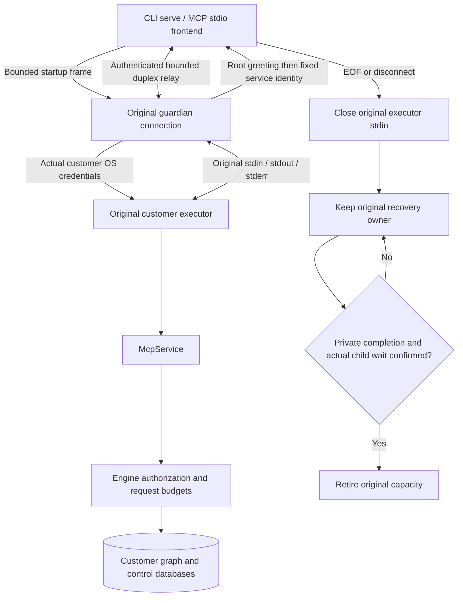

# Linux guardian stdio MCP candidate / Linux guardian stdio MCP 候选

此接线尚待原生 CI 验收，不代表可安装桌面服务或全平台生产就绪。沿用 OpenSpec `implement-diskgraph-platform` 的 PF-06 guardian＋客户 executor 合同。

This integration still requires native CI qualification. It does not qualify desktop service installation or production readiness across platforms. It implements the existing PF-06 guardian and customer executor contract.

## 入口 / Entry points

受信安装选择数据目录及 MCP/worker 镜像；前端只指定固定 socket。支持以下两个等价 stdio 入口：

The trusted installation selects the data directory and MCP/worker images. The frontend selects only the fixed socket. The equivalent stdio entry points are:

```sh
diskgraph-mcp --supervisor-socket /trusted/installation/front.sock
diskgraph --supervisor-socket /trusted/installation/front.sock serve
```

此入口固定 `read-full` 展示配置；工具展示不授予资源权限。自定义数据目录、主体、profile、HTTP/SSE 及认证配置不被静默忽略。旧安装缺少完整 MCP 镜像绑定时拒绝启动，禁止从相邻文件推导信任。

These entry points use the fixed `read-full` catalog profile, which does not grant resource permissions. Data-directory, principal, profile, HTTP/SSE and authentication overrides are rejected rather than ignored. Older installations without a complete MCP image binding cannot start a session; adjacent files do not establish trust.



## 预算与验收 / Budgets and qualification

- 启动预算 30 秒；不作为持续 MCP 会话总寿命。每笔交付 30 秒，Engine 原查询预算与撤权检查保持独立。
- 单行 stdio 请求最多 1 MiB，含行终止字节；在扩容及分发前拒绝。会话输入、输出合计最多 2 GiB。
- 公开断开不证明恢复完成。原私有完成与实际 wait 均确认后才退休容量。
- CI 夹具执行原安装器生成的真实 systemd unit，以真实客户运行两个入口，初始化、列工具、查询 CLI 发布的 revision；MCP 原会话空闲 31 秒后仍须查询，再验证正常 EOF 和原容量退休。

- Startup has a 30-second budget, separate from the persistent session lifetime. Each delivery has a 30-second budget; Engine query budgets and revocation checks remain independent.
- A stdio request line is limited to 1 MiB including line termination, before allocation growth or dispatch. Combined session input and output are limited to 2 GiB.
- Public disconnection does not prove recovery. Original capacity retires only after authenticated private completion and actual child wait.
- The CI fixture runs the installer's original systemd units and both product entry points as the real customer. It initializes MCP, lists tools, queries a CLI-published revision, checks the same MCP session after 31 seconds idle, and verifies normal EOF and original capacity retirement.

HTTP/SSE guardian 接线、异常 I/O 的停止与回收资格、LSM 完整保真及 macOS/Windows 服务验收仍开放。Linux 条件代码本机 macOS 未编译或执行，必须以当前源码原生 CI 结果验收。

Guardian HTTP/SSE integration, pending-I/O shutdown/recovery qualification, full LSM fidelity, and macOS/Windows services remain open. Linux-specific code has not been compiled or executed on this macOS host and requires native CI evidence for the current source.
