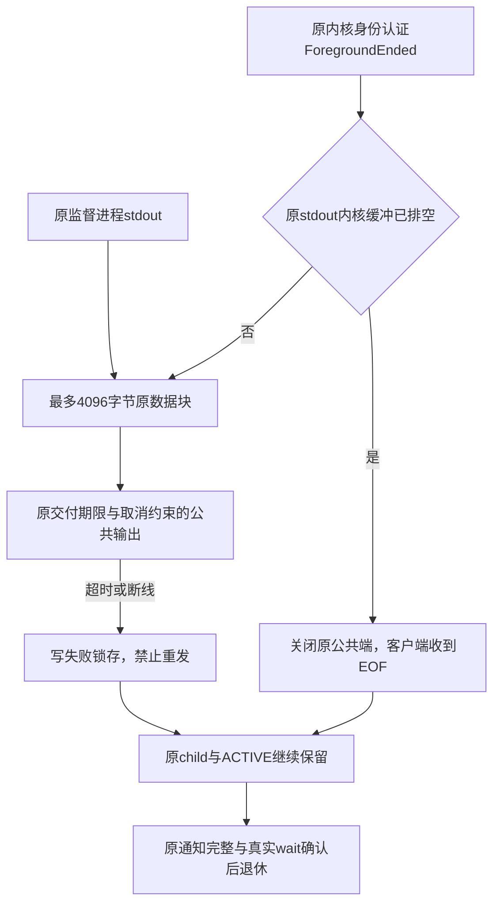

# 公共输出交付与原恢复责任

状态：Unix组件本机验收完成，Linux父侧接线待原生验收；公共broker与三平台服务未完成。沿用既有PF-06合同，数据库250ms、能力回调50ms不变。

UnixForegroundOutput只持有公共输出，不认证客户、不释放恢复资源。可信内部LinuxSupervisorProcess接线要求宿主已经认证前端，不能把任意socket交付作为用户授权。ForegroundEnded来自原逐消息认证控制流；原read的None可能代表EINTR，因此另查FIONREAD，不以None直接宣称排空。

组件本机3项测试检查真实EOF、预算/取消锁存、满socket超时和断线SIGPIPE防护；独立保留的socket仅证明输出与资源引用分离，不证明原OS进程退休。第五项root原生测试增加公共EOF已发生时原pidfd仍未退出、bootstrap仍ACTIVE的断言，后续仍须原wait才能CLEAN。该测试当前未运行新源码。

超时/取消失败路径另行先红后绿：仅锁存错误仍留下公共端导致真实接收超时（0/1），实现同步关闭原公共端后3/0。关闭错误不覆盖原交付错误；原监督进程、ACTIVE与恢复资源仍由外部owner持有。

未完成：公共broker启动和认证、MCP输入转发及完整公开stdio协议、stderr交付与有界恢复诊断、前端真实进程退出、HTTP部署生命周期、macOS/Windows服务及安装链。不得将本组件称为完整有限前台退出或生产服务。
