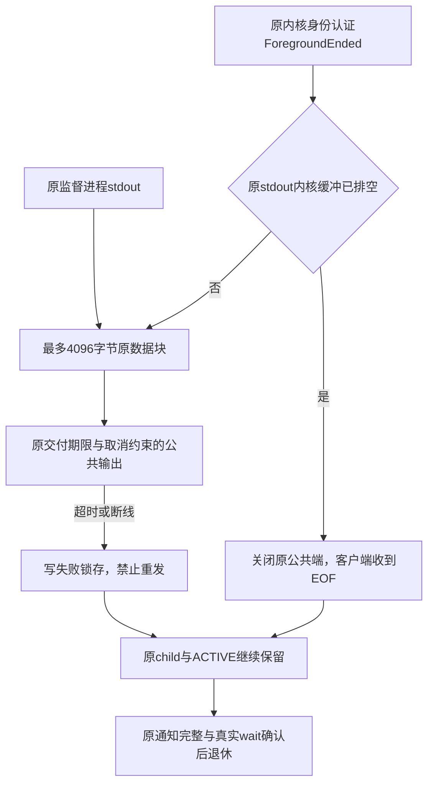
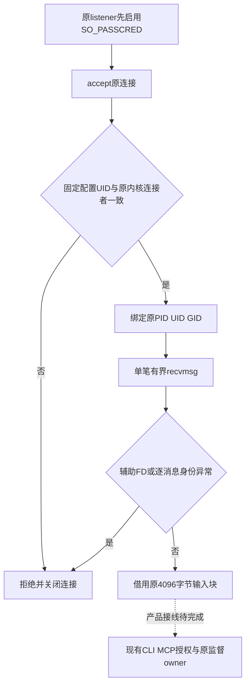

# 公共输出交付与原恢复责任

状态：Unix组件本机验收完成，Linux父侧接线在126cc4ce的Linux x86_64 MSRV原生资格通过，stable负控仍有失败；公共broker与三平台服务未完成。沿用既有PF-06合同，数据库250ms、能力回调50ms不变。

UnixForegroundOutput只持有公共输出，不认证客户、不释放恢复资源。可信内部LinuxSupervisorProcess接线要求宿主已经认证前端，不能把任意socket交付作为用户授权。ForegroundEnded来自原逐消息认证控制流；原read的None可能代表EINTR，因此另查FIONREAD，不以None直接宣称排空。

组件本机3项测试检查真实EOF、预算/取消锁存、满socket超时和断线SIGPIPE防护；独立保留的socket仅证明输出与资源引用分离，不证明原OS进程退休。第五项root原生测试增加公共EOF已发生时原pidfd仍未退出、bootstrap仍ACTIVE的断言，后续仍须原wait才能CLEAN。该测试在126cc4ce的Linux x86_64 MSRV原生门禁通过，生产组件与当前工作树摘要一致；不能替代全平台服务。

超时/取消失败路径另行先红后绿：仅锁存错误仍留下公共端导致真实接收超时（0/1），实现同步关闭原公共端后3/0。关闭错误不覆盖原交付错误；原监督进程、ACTIVE与恢复资源仍由外部owner持有。

输入接线增量：Linux父侧write_stdin_until提供最多4096字节原输入块、原deadline/取消检查、按实际发送量推进和失败关闭；finish_stdin只关闭原输入，不能据此释放child或ACTIVE。共用UnixControlChannel新测试3/0及旧输入回归9/0在本机通过。第七项root原生验收已定义，要求逐字节输入及stdin EOF、公共EOF、原pidfd仍活着和ACTIVE保留，最后仍须原材料屏障/原wait才能CLEAN；126cc4ce Linux x86_64 MSRV的第七项真实Rust门禁已通过；当前新增真实CLI测试尚未执行。

未完成：公共broker启动和认证、完整公开MCP stdio转发的产品接线、stderr交付与有界恢复诊断、前端真实进程退出、HTTP部署生命周期、macOS/Windows服务及安装链。不得将本组件称为完整有限前台退出或生产服务。

## Linux公共连接认证接线

LinuxFrontendConnection接受原公共连接及受信部署配置中的非root UID。原listener必须在accept之前启用SO_PASSCRED；构造核对SO_PEERCRED的UID并绑定原PID/UID/GID，每笔recvmsg再比较实际SCM_CREDENTIALS，防止连接转交后沿用创建者身份。固定4096字节缓冲、不分配整条请求，辅助FD由共用校验先关闭再拒绝；错误锁存并关闭公共端，失败不得转成输出owner。输入半关闭允许先完成原输出。

组件不提供socket目录/安装者信任，不授予Engine管理员或远程token能力。现有HTTP/SSE请求授权仍需原token与实时数据库权限交集。四项Rust原生资格测试已定义并纳入CI，126cc4ce Linux x86_64 MSRV四项真实Rust门禁通过，生产组件与当前工作树摘要一致；隔离LinuxARM的C客户端与内核探针已验证测试角色、SO_PASSCRED继承、同UID不同发送PID及意外FD关闭，只是资格夹具证据。

## CLI失败正文与前台结束顺序

CLI操作返回失败时，既有有限错误envelope必须在原执行栈结束及ForegroundEnded通知之前写入并flush；不得等原恢复退休后才生成正文。保持原业务错误和退出码，外层不得重复交付。BrokenPipe或flush失败不能吞掉原业务失败，也不能在公共EOF后再次尝试写正文。成功输出flush错误应作为实际交付失败；启动准入失败仍由外层交付。回归需验证失败正文、flush顺序、原错误优先级及禁止重发；本增量不关闭broker与完整原生退出门禁。

## 真实CLI纵向资格

增加独立root原生测试，使用本次构建的实际diskgraph与diskgraph-scan-worker，不以C角色替代业务。隔离root保护目录预置bootstrap和服务槽、服务UID独占数据库，原子launcher通过schema3材料、原ClockStamp、原内核身份通知接入既有doctor。验收真实JSON与公共EOF之后bootstrap仍ACTIVE，最终原wait、私有完成与服务CLEAN全部成立才写bootstrap CLEAN。此项无异常Pending注入。新增独立UID 23112前端持有原公共连接，逐消息内核身份核验后才认领bootstrap；实际stdout EOF与原Child wait成功必须先于监督owner退休。C前端只转交真实CLI字节，不代替业务。隔离Linux ARM夹具四场景通过：原角色缺失doctor模式拒绝、Unicode完整分片、128KiB超限拒绝、原4KiB stdout管道背压约30秒退出。Rust纵向测试尚未原生执行；不证明公开broker服务或安装信任已经完成。

## 原生短竞争夹具资格

数据库终检250ms与能力50ms不变。指定短持锁100ms的原生线程可能被调度拖到248ms/281ms，不能将这样的输入称为已完成短竞争验收。持锁时长在释放前记录；短竞争仅在实际持锁不超过max(名义持锁,注入唤醒延迟)+30ms时判定。每个原场景最多五次独立隔离夹具尝试，保留每次原期限与结果日志；调度不合格只能得到成功或BudgetExceeded，权限/存储等其他错误立即失败。五次均无法形成所需输入时仍失败，不能跳过。500ms持锁、60ms整次请求及所有250ms/50ms拒绝要求保持原样，不通过重试原业务续期。
