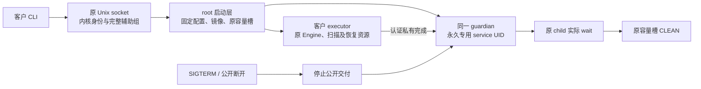

# PF-06 原连接 guardian 与客户 executor 增量

延续已批准的专用 service UID guardian＋真实客户 OS 凭据 executor 合同，不缩减完整只读 CLI/MCP 或三平台验收。

## 可观察行为

- 固定 `--connection` 入口仅接受 stdin 上的原 AF_UNIX STREAM。监听者必须先于客户发送启用 SO_PASSCRED；实际客户 UID/GID/完整辅助组来自同一内核连接，非请求正文。
- root 启动层只打开受信配置、原镜像及容量槽。客户 executor 不获得 root 目录、namespace 或容量 FD，原 Engine/pending 资源始终留在客户 executor。
- 原 guardian 在认证出生后，永久变为配置中的专用 UID/GID；三组身份一致、辅助组清空、能力全清、NNP=1、dumpable=0。降权失败禁止公开结果交付，原 owner/ACTIVE 保留。
- 客户数据库由客户 UID 创建。代码镜像对客户只可执行，不可读取。旧 service slot 不被客户 executor 使用。
- 公开 EOF/超时不能释放容量或污染私有恢复资格。只有认证完成和原 child 实际 wait 才允许原 bootstrap CLEAN。
- 运行期限与启动期限继续按原合同分别处理；本增量不增加扫描时间上限。
- 新安装模式 `--with-guardian --frontend-gid GID` 与旧 broker 模式互斥，独占创建新目录。数据目录实际 owner 为客户 UID/GID、0700；CLI/MCP/worker 镜像为 root 0511。安装 receipt 记录真实 fstat 身份，不凭期望值声称已安装。
- socket activation 采用原 accepted stdin、SO_PASSCRED 和最多四连接；监听 socket 只允许配置客户访问。模板只向原 guardian 发 SIGTERM、不对原 child 强制 SIGKILL；停止期限不替代资源退休。
- guardian 的 SIGTERM/SIGINT handler 只锁存原进程 atomic 停止标记。工作出生前取消准入；已收到请求后的认证出生按原有限期限完成，停止公开交付后继续同一原私有恢复。

systemd 属性依据官方 [socket contract](https://raw.githubusercontent.com/systemd/systemd/main/man/systemd.socket.xml)、[stdin contract](https://raw.githubusercontent.com/systemd/systemd/main/man/systemd.exec.xml) 和 [kill contract](https://raw.githubusercontent.com/systemd/systemd/main/man/systemd.kill.xml)。静态产物检查不能代替实际 unit 启动/停止。

## 验收与实际边界

- 隔离 Linux ARM64 C 层真实身份切换四例已通过：合法专用身份、无效 UID、无效 GID、非 root 调用。合法例实际恢复 root 返回 EPERM。
- 严格 ARM64/x86_64 C 编译通过；x86_64 运行未由本机证明。
- 本机 Rust 源码门禁 6/6，通过 macOS all-target Clippy；Linux 条件编译主体不被这些结果覆盖。
- `scripts/qualify_linux_guardian.py` 使用原 accepted socket、真实客户辅助组、当前 CLI/worker/supervisor 产物，要求公开 doctor 完成、客户 UID 数据库、原 guardian 正常 wait、同一 bootstrap CLEAN；另验客户发完同一请求后立即断开，仍须原正常 wait 后 CLEAN。尚待原生 CI，不声称已有运行红灯或绿灯。
- 本增量尚不证明扫描/完整查询、MCP、systemd 生命周期、LSM 上下文保真、macOS/Windows 服务或生产就绪。父任务不勾选。
- 前序源码 eb80d492 的 CI 38195149112 已终态成功，23/23 job 和五种原生包通过，原始 run 保留于 `docs/benchmarks/ci_eb80d492_terminal_2026_10_12/`。它未包含本 guardian 候选，不能替代新运行验收。
- 安装增量 TDD：三项新测试在旧 API 缺少参数/产物生成器时出现五个 API 错误，并非原生行为红灯；另一个 ListenStream 原路径测试复现 ExecStart 引号误用的行为失败，修复后 4/4 通过，旧安装回归 19/19 通过。ListenStream 原值经 unit_path_printf/socket_address_parse 解析，不能套用参数引号，依据 [systemd parser](https://raw.githubusercontent.com/systemd/systemd/main/src/core/load-fragment.c)。原生夹具已改为真正经过四镜像归档/独占安装器，并加入工作出生前的真实 SIGTERM/公开 EOF/数据库未出生检查；仍待新源码 CI，不声明已通过。
- 49ddf456 的 Linux x86_64 MSRV 完整 job 114647404768 已成功；实际 guardian doctor 与公开断开两例均通过，客户 UID 数据库、原 guardian wait、原 bootstrap CLEAN、旧 service slot 不触碰，C 专用身份四例通过。原日志与 source/job 绑定保留于 `docs/benchmarks/guardian_native_and_intel_load_49dd_2026_10_12/`。该源码尚未包含新安装模式与停止 handler，不能覆盖它们。
- 新 `qualify_linux_guardian_unit.py` 将安装器生成的真实 socket/template 原字节独占写入随机同名前缀的 `/run/systemd/system`，仅在显式隔离 runner 使用；static verify 后真正启动、由客户 CLI 查询、检查原槽 CLEAN 与客户数据库，再停止本次 socket。原实例正常结束前不移除 unit/安装树，失败保留；不 enable。此运行门禁尚未执行，不勾选服务父项或 pending-stop/MCP/scan 验收。

## 真实 CLI guardian 身份接线修复

受信安装器生成 root 所有、不可写的公开 `guardian-frontend.json`，只声明 schema、固定 socket、客户 UID 与 guardian UID/GID，不含私有出生/容量材料。客户通过逐组件 no-follow 原句柄读取并核验；存在但损坏时禁止降级到旧模式。新模式接受受保护目录中指定客户所有的 0600 socket，并仍要求连接创建者为 root。原 guardian 在收到实际客户请求并认证原 executor 出生后、永久降权前发送固定 root 凭据握手；客户从原 socket 的 SCM_CREDENTIALS 绑定该原 PID，再仅接收同 PID 与安装指定 guardian UID/GID 的业务帧。socket activation 的 root 监听者 PID 不被误当成每个 guardian 的 PID。旧 broker 无 manifest 时保持原 root/PID 三元组校验，不放开旧委托负向测试。

验收包括公开 manifest 布局/严格解码、真实客户 CLI direct accepted 与 systemd socket、错误 manifest/非 root 握手/不同 PID 或 UID 拒绝；原生 Linux 未运行前不记通过。此修复不声明扫描/MCP 或平台父项完成。

握手交付失败与原恢复责任分开：即时断开夹具仍在原请求发送后立即关闭，不等待新握手；原 guardian 完成原私有出生认证，永久降权后继续原 wait/退休，不据公开握手错误释放或抛弃原 owner。该既有负例保留原断开时序与客户数据库断言。

本机共同组件20/20、源码布局6/6、Linux安装脚本67/67、vendor pin/摘要4/4及macOS Engine all-target Clippy通过。安装绑定首次测试为API缺失错误，不称原生行为红灯。三项真实root消息/原manifest负例已接入Linux独立root门禁，并检查精确测试存在；仍未执行。候选源码摘要与实际边界见 `docs/benchmarks/guardian_frontend_binding_candidate_2026_10_12/receipt.json`。
