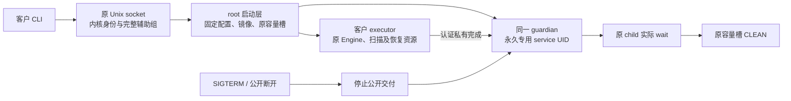

# PF-06 原连接 guardian 与客户 executor 增量

## 原连接 MCP 会话接线验收

stdio MCP 前端通过原guardian连接进入真实客户executor，固定MCP镜像路径/完整摘要只能取root安装配置。旧配置无MCP材料时拒绝MCP，不猜测邻接镜像，不进入旧service身份路径。启动使用有界版本化长度帧而不关闭写端；前端在root认证握手完成前不得发送RPC。后续每笔客户输入及guardian输出继续核对原PID/UID/GID；原stdout/stderr和终态有界转发。启动期限仍为原30秒，长会话不得使用该期限作为整次MCP生命周期上限；单笔交付保留有限期限，原MCP请求的权限/查询预算不变。输入EOF关闭同一executor stdin；公开断开/超时/停止后保留同一Engine、私有恢复通道、child和容量，原私有完成且实际wait后才CLEAN。实际验收需从产品MCP前端初始化、列工具、查询真实已发布revision、正常EOF和原退休，负例拒绝旧安装/未知参数/启动帧尾随数据/不同发送身份。HTTP/SSE及其他平台服务保持开放，不能据stdio用例关闭全平台父项。

stdio单行请求与HTTP正文采用1MiB上限（stdio包括行终止字节），在扩容和分发前拒绝超长行；非法UTF-8沿原错误语义结束。几何扩容显式封顶，不将2GiB会话转发总量作为单行内存额度。会话输入和输出合计2GiB后明确结束，单笔交付30秒；原查询执行预算不因此续期。原生夹具必须在同一会话空闲31秒后查询实际revision，证明启动30秒不是长会话总寿命。

两项固定MCP描述/镜像绑定测试确认行为RED0/2；CLI serve监督入口确认行为RED0/1。候选实现后本机监督组件26/26、CLI监督6/6、MCP前端1/1、stdio有界读取2/2、Engine规范6/6、MCP规范11/11、guardian脚本7/7与旧安装回归19/19通过，三包macOS all-target Clippy通过。有界读取先由源码确认旧lines无上限，新增纯读取回归通过；没有把它说成完整服务运行红灯。Linux条件代码尚未原生编译或执行，不关闭平台父项；候选接口及预算见 `docs/linux_guardian_stdio.md`。

57d71c0d的Windows stable job114670916260终态失败，Engine原句柄隔离用例通过；唯一失败目标为 scope_authorization_projection_tests 的普通scope完整display：消费者已进入、两次授权允许、Rust requested=3841，实际返回BudgetExceeded。后续步骤运行不代表完整测试成功；原日志保存于 `docs/benchmarks/scope_projection_windows_57d71c0d_2026_10_12/`。原50ms整次查询、250ms数据库窗口、50ms能力回调预算及所有原成功断言保持不变，仅增加成功/失败路径的消费者与末段回调时间诊断，未把诊断称为修复。本机该5项回归与目标Clippy通过，不能替代Windows失败验收；此前句柄异常也不能据本轮一次通过声明根因已消除。

## 扫描配置兼容验收

监督入口的 index/sync 必须传递实际 CLI 指定的节点与编码 staging 预算，以及 apparent-size、no-hidden、one-filesystem、cross-filesystems、depth、no-dedup-hardlinks。参数仍采用固定白名单并逐项验证，值与开关保持单一 argv；真实客户 executor 使用既有 CLI/Engine 配置解析和预算检查，不新增执行身份或数据域选择能力。非扫描命令不得静默忽略这些覆盖。验收要求真实 Clap 往返保持全部配置，非法数字/主体/数据目录注入被拒绝，原生扫描使用明确的小预算完成正常发布；实现与原生验证分别记录，不提前关闭父项。

本轮两个新增扫描配置测试分别确认行为RED0/1，修复后监督组件23/23、实际CLI监督映射5/5、Engine源码规范6/6、macOS Engine/CLI all-target Clippy通过。Python失败诊断RED1/2后修复，guardian脚本7/7通过；固定YAML及OpenSpec严格校验通过。额外尝试三个scan_terminal测试均在打开Engine阶段返回Unsupported，本机没有受信macOS固定安装；不计通过、不以环境模拟授予安装资格，交由原生CI既有门禁验证。

57d71c0d的CI38206461160三个Linux job均到达真实systemd socket启动后失败，原始stable日志归档于 `docs/benchmarks/guardian_scan_options_57d71c0d_2026_10_12/`。旧日志没有systemctl stderr/journal，不能单凭它认定根因。核对systemd v255 socket.c#socket_chown：SocketUser会get_user_creds同时解析主组；夹具此前仅在内核设置23112，没有NSS账户。新CI只在临时runner创建固定真实客户和辅助组，碰撞拒绝；产品unit安全属性不变。失败时记录原stderr及同一unit状态/最后30条journal，不重试start/stop，不释放原资源。原生修正尚待运行，平台父项保持开放。

延续已批准的专用 service UID guardian＋真实客户 OS 凭据 executor 合同，不缩减完整只读 CLI/MCP 或三平台验收。

## 可观察行为

- 固定 `--connection` 入口仅接受 stdin 上的原 AF_UNIX STREAM。监听者必须先于客户发送启用 SO_PASSCRED；实际客户 UID/GID/完整辅助组来自同一内核连接，非请求正文。
- root 启动层只打开受信配置、原镜像及容量槽。客户 executor 不获得 root 目录、namespace 或容量 FD，原 Engine/pending 资源始终留在客户 executor。
- 原 guardian 在认证出生后，永久变为配置中的专用 UID/GID；三组身份一致、辅助组清空、能力全清、NNP=1、dumpable=0。降权失败禁止公开结果交付，原 owner/ACTIVE 保留。
- 客户数据库由客户 UID 创建。代码镜像对客户只可执行，不可读取。旧 service slot 不被客户 executor 使用。
- 公开 EOF/超时不能释放容量或污染私有恢复资格。只有认证完成和原 child 实际 wait 才允许原 bootstrap CLEAN。
- 运行期限与启动期限继续按原合同分别处理；本增量不增加扫描时间上限。
- 新安装模式 `--with-guardian --frontend-gid GID` 与旧 broker 模式互斥，独占创建新目录。数据目录实际 owner 为客户 UID/GID、0700；CLI/MCP/worker 镜像为 root 0511。安装 receipt 记录真实 fstat 身份，不凭期望值声称已安装。
- socket activation 采用原 accepted stdin、SO_PASSCRED 和最多四连接；监听 socket 只允许配置客户访问。模板只向原 guardian 发 SIGTERM、不对原 child 强制 SIGKILL；停止期限不替代资源退休。
- guardian 的 SIGTERM/SIGINT handler 只锁存原进程 atomic 停止标记。工作出生前取消准入；已收到请求后的认证出生按原有限期限完成，停止公开交付后继续同一原私有恢复。

systemd 属性依据官方 [socket contract](https://raw.githubusercontent.com/systemd/systemd/main/man/systemd.socket.xml)、[stdin contract](https://raw.githubusercontent.com/systemd/systemd/main/man/systemd.exec.xml) 和 [kill contract](https://raw.githubusercontent.com/systemd/systemd/main/man/systemd.kill.xml)。静态产物检查不能代替实际 unit 启动/停止。

## 验收与实际边界

- 隔离 Linux ARM64 C 层真实身份切换四例已通过：合法专用身份、无效 UID、无效 GID、非 root 调用。合法例实际恢复 root 返回 EPERM。
- 严格 ARM64/x86_64 C 编译通过；x86_64 运行未由本机证明。
- 本机 Rust 源码门禁 6/6，通过 macOS all-target Clippy；Linux 条件编译主体不被这些结果覆盖。
- `scripts/qualify_linux_guardian.py` 使用原 accepted socket、真实客户辅助组、当前 CLI/worker/supervisor 产物，要求公开 doctor 完成、客户 UID 数据库、原 guardian 正常 wait、同一 bootstrap CLEAN；另验客户发完同一请求后立即断开，仍须原正常 wait 后 CLEAN。尚待原生 CI，不声称已有运行红灯或绿灯。
- 本增量尚不证明扫描/完整查询、MCP、systemd 生命周期、LSM 上下文保真、macOS/Windows 服务或生产就绪。父任务不勾选。
- 前序源码 eb80d492 的 CI 38195149112 已终态成功，23/23 job 和五种原生包通过，原始 run 保留于 `docs/benchmarks/ci_eb80d492_terminal_2026_10_12/`。它未包含本 guardian 候选，不能替代新运行验收。
- 安装增量 TDD：三项新测试在旧 API 缺少参数/产物生成器时出现五个 API 错误，并非原生行为红灯；另一个 ListenStream 原路径测试复现 ExecStart 引号误用的行为失败，修复后 4/4 通过，旧安装回归 19/19 通过。ListenStream 原值经 unit_path_printf/socket_address_parse 解析，不能套用参数引号，依据 [systemd parser](https://raw.githubusercontent.com/systemd/systemd/main/src/core/load-fragment.c)。原生夹具已改为真正经过四镜像归档/独占安装器，并加入工作出生前的真实 SIGTERM/公开 EOF/数据库未出生检查；仍待新源码 CI，不声明已通过。
- 49ddf456 的 Linux x86_64 MSRV 完整 job 114647404768 已成功；实际 guardian doctor 与公开断开两例均通过，客户 UID 数据库、原 guardian wait、原 bootstrap CLEAN、旧 service slot 不触碰，C 专用身份四例通过。原日志与 source/job 绑定保留于 `docs/benchmarks/guardian_native_and_intel_load_49dd_2026_10_12/`。该源码尚未包含新安装模式与停止 handler，不能覆盖它们。
- 新 `qualify_linux_guardian_unit.py` 将安装器生成的真实 socket/template 原字节独占写入随机同名前缀的 `/run/systemd/system`，仅在显式隔离 runner 使用；static verify 后真正启动、由客户 CLI 查询、检查原槽 CLEAN 与客户数据库，再停止本次 socket。原实例正常结束前不移除 unit/安装树，失败保留；不 enable。此运行门禁尚未执行，不勾选服务父项或 pending-stop/MCP/scan 验收。

## 真实 CLI guardian 身份接线修复

受信安装器生成 root 所有、不可写的公开 `guardian-frontend.json`，只声明 schema、固定 socket、客户 UID 与 guardian UID/GID，不含私有出生/容量材料。客户通过逐组件 no-follow 原句柄读取并核验；存在但损坏时禁止降级到旧模式。新模式接受受保护目录中指定客户所有的 0600 socket，并仍要求连接创建者为 root。原 guardian 在收到实际客户请求并认证原 executor 出生后、永久降权前发送固定 root 凭据握手；客户从原 socket 的 SCM_CREDENTIALS 绑定该原 PID，再仅接收同 PID 与安装指定 guardian UID/GID 的业务帧。socket activation 的 root 监听者 PID 不被误当成每个 guardian 的 PID。旧 broker 无 manifest 时保持原 root/PID 三元组校验，不放开旧委托负向测试。

验收包括公开 manifest 布局/严格解码、真实客户 CLI direct accepted 与 systemd socket、错误 manifest/非 root 握手/不同 PID 或 UID 拒绝；原生 Linux 未运行前不记通过。此修复不声明扫描/MCP 或平台父项完成。

握手交付失败与原恢复责任分开：即时断开夹具仍在原请求发送后立即关闭，不等待新握手；原 guardian 完成原私有出生认证，永久降权后继续原 wait/退休，不据公开握手错误释放或抛弃原 owner。该既有负例保留原断开时序与客户数据库断言。

本机共同组件20/20、源码布局6/6、Linux安装脚本67/67、vendor pin/摘要4/4及macOS Engine all-target Clippy通过。安装绑定首次测试为API缺失错误，不称原生行为红灯。三项真实root消息/原manifest负例已接入Linux独立root门禁，并检查精确测试存在；仍未执行。候选源码摘要与实际边界见 `docs/benchmarks/guardian_frontend_binding_candidate_2026_10_12/receipt.json`。

7af8f3bb 的 CI38202907367/Linux stable job114659992984 原生第一例真实客户CLI失败，stdout/stderr为空，未进入systemd验收；原日志已保留在上述候选回执。日志只证明公开CLI失败，凭据不兼容原因来自当前源码核对，不能把它说成日志已显示的诊断。公开CLI现在将实际监督协议错误写stderr，夹具也保留真实退出码，便于下一轮区分准入/握手/交付错误；退出码与stdout协议不变。

## 原客户扫描主线接线

guardian新增固定scope add、index与无collector的sync命令，仍只改变本客户数据库，不启用文件移动/删除/restore工具。注册目录以Locator原OS编码传输，display不作为目标；禁止NUL、超长输入、URI和任意全局开关。scope add、index/sync仅进入真实客户executor；旧service身份broker及内部旧出生入口必须在工作出生前拒绝这些命令。注册、排队、扫描、发布继续走现有Engine授权/预算/容量/fencing入口。

扫描使用已有扫描执行预算，30秒仅为有限公开连接/启动观察窗口，不改为30秒扫描上限。公开截止/即时断开后原executor仍保有Engine与扫描/恢复资源，原guardian继续原私有恢复和wait；原资源退休前不能标记容量CLEAN。--wait的正常小目录必须形成实际revision并可再从监督入口查询；未知scope不得入队，非UTF-8目录必须保留原定位。自定义扫描选项、collector与MCP接线仍开放，不据默认扫描主线关闭完整父项。

扫描固定查询行为RED0/1：原index/sync wait被原validator拒绝；实现后Engine监督组件22/22、实际Clap映射3/3及非UTF-8原参数往返1/1、Engine布局6/6和CLI布局2/2、guardian脚本6/6、macOS两包Clippy通过。真实systemd夹具已串接两份不同原始编码根、index发布/node读取/Unicode搜索/sync发布/未知scope不入队及每步原槽退休；尚未原生执行，不关闭父项。另7af8同源码Intel原生包job114660072829成功，stdio18、HTTP14、升级回滚7、20k/200k各6检查；这是该源码包复验，不是新扫描接线或配对性能证明。原日志与候选摘要见 `docs/benchmarks/guardian_scan_mainline_candidate_2026_10_12/receipt.json`。

7af8 Windows stable job114659992942 的Engine实际794/1/8；唯一失败为未继承parent handle的stdout缺isolated标记，exit_code原断言已通过。当前日志没有原父事件状态或输出，不能认定handle泄露、数字复用或输出丢失。仅增加同一原父事件即时观察与最多2048字节stdout/stderr诊断，保留两个原断言、原期限和原进程，不称根因修复。原始日志及候选诊断摘要将随新验收保留。

该Windows诊断另记录子进程实际SetEvent返回值；两个原负例断言通过后才触发同一原父事件正控并要求WAIT_OBJECT_0，不用正控替代继承负例。原日志见 `docs/benchmarks/windows_parent_event_diagnostic_7af8_2026_10_12/receipt.json`；Windows条件主体本机未执行，不称根因修复。
