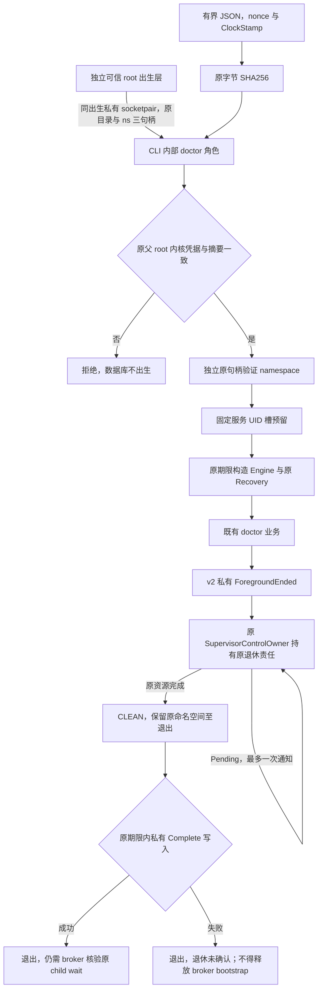

# Linux 监督 doctor 出生接线

状态：已接入 Engine/CLI 构造、原 owner 与 v2 私有退休通知；558d73f9 的三平台 CI 38122312895 正在验收；同源码 release 归档已在隔离 Linux ARM64 环境通过 v2 全部14场景，完整 CI 尚无终态。d76ad70f 的八场景和69b30d9b的22/23全量结果仅适用于各自源码。公共 broker、原 child 全局容量寿命、broker 完整退休确认和有限前端退出未完成，不关闭监督服务父项。

两个内部环境值只指定原启动 JSON 和唯一继承的私有 FD。环境自身不授予资格：JSON 原字节 SHA 必须由原父进程的真实 root UID/GID/PID 内核消息凭据确认，接收身份必须为已绑定的非 root 专用 UID。JSON 限4KiB，字段严格拒绝未知键，固定版本、不同服务/前端 UID、64位十六进制 nonce/摘要、绝对无别名定位与64MiB镜像上限。所有认证和身份失败在 Engine/数据库之前拒绝；既有普通本地入口保持兼容，配置内部角色后的错误绝不回退。

私有描述符须为已连接未命名 AF_UNIX datagram，拒绝 stdio、普通文件、stream 和其他 socket domain，采用后立即恢复 CLOEXEC。原 ClockStamp 采用两次扣除实际认证成本；之后构造仍取调用方原期限的较小值。namespace 及三原对象在预留、构造、出生前撤销和 SupervisorOwner 退休完整期间保留。root 出生材料指定镜像与数据目录，不采用旧环境镜像配置，客户端 argv 不得替换数据目录。内部角色当前仅接既有 `--json doctor`，禁止转交 serve 或其他命令。

root 内核凭据不代替固定 broker 的发行、镜像与生命周期信任。当前 v2 已发送原 owner 绑定的退休私有通知，但尚无公共 broker、全局 bootstrap owner、broker 对私有通知与原 child wait 的完整确认或有限前端退出；仍等原资源退休再返回。不得把本构造组件称为独立服务已部署或恢复完成。本轮不安装桌面服务。

证据：`docs/benchmarks/linux_supervisor_birth_constructor/receipt.json`。旧0e90二进制在Linux隔离专用UID运行时忽略新角色标记，创建了数据库，为新协议缺失RED，不把它报告成旧CLI提权漏洞。八场景在旧二进制实际执行1通过/7拒绝失败，全部原child已wait、原容器已移除；此处只证明新协议缺失。共享解析真实RED1/2→GREEN3/0；macOS兼容host9/0、两包全目标Clippy通过。这些不编译Linux条件分支、不替代Linux验收。新增原生脚本对当前实际镜像完成CLEAN、ACTIVE、伪造角色、错误session、非root实际发送者、过期材料、错误镜像、数据定位替换八个场景；只有它在当前Linux源码构建后运行通过才能关闭对应子门禁。

## 5371e15 原生构造验收发现与修复

当前源码确实在Linux ARM64 CI编译并发布候选归档；独立核对checkout、原job归档摘要和实际归档后，在隔离root容器执行实际二进制。八场景结果为7通过/1失败：wrong_image同长度错误SHA仍成功创建数据库。原因是Linux可信内部ScanWorkerHost只保留预期材料，在扫描执行前才做sealed image校验，doctor未扫描，不能把Host构造当作完整镜像准入。

新监督出生路径在原held镜像上逐次读取剩余额度内的字节、完整SHA、dev/inode/length及纳秒mtime/ctime一致后才构造Engine；缓冲固定64KiB，原期限不刷新，EINTR重试仍检查期限，最终定位重绕同一File。最终路径打开加入NONBLOCK以避免普通文件检查前被FIFO打开阻塞。旧内部Host API保持兼容，不将该校验强加到其他可信本地调用。

新验证helper本机3/0、Clippy和格式检查通过，修复后的Linux原生验收仍待执行。原7/1失败及成功创建数据库的完整结果、实际原子进程wait和容器移除证据全部保留在`docs/benchmarks/linux_supervisor_birth_image_verification/`，不得称为8/8，也不关闭服务父门禁。

同一5371e15的三个Linux矩阵在Engine/CLI/MCP测试步骤失败，实际唯一失败目标为source_layout：两个新对象缺少现有门禁要求的“来源：”标记。原日志分别保留，补正文档而不放宽门禁，本机6/0通过；未把测试中预期的catch_unwind panic误判为失败。矩阵未运行到构造门禁，7/1证据来自该源码真实release归档的独立原生运行。

## d76ad70f 原生八场景与夹具保护边界

独立核对原 CI job 114404388500 的源码、归档摘要和实际归档，在不联网的一次性 Linux ARM64 容器中执行实际 CLI/worker。原生八场景全部通过，wrong_image 精确 Conflict 且数据库不出生；所有原 child 已实际 wait，两次容器均已移除。该结果关闭完整镜像验证与 doctor 构造的 Linux ARM64 子项，不证明公共 broker、异常 I/O 下有限前端退出或其他平台监督服务资格。

当前 CI 的 Linux 构造步骤返回 Unsupported。原 runner 祖先权限未记录，因此尚不能断定具体根因；在同一 d76ad70f 二进制、隔离容器中将 /opt 设置为 0777，原 /opt 夹具实际重现四个 Unsupported 失败。生产目录校验未修改。新夹具使用 /var/lib，先核对 /、/var、/var/lib 的 root 身份、真实目录类型与不可组/其他写，拒绝不安全祖先；显式设置本轮新目录权限，回执同时记录 /opt 权限。同一受保护夹具八场景通过。CI 上的新夹具仍需原生执行证明。

证据见 `docs/benchmarks/linux_supervisor_birth_protected_fixture/receipt.json`、原失败、隔离重现和新的 native_green.json；旧失败报告保持原样。

## 原 owner 与私有完成通知的绑定验收

监督通知接线必须同时持有同一 `SupervisorOwner` 与唯一私有 writer；只有原 owner 的实际退休返回 true 后才能写 CleanupComplete。原扫描预留、外部 Engine 引用、原恢复错误均不得产生完成帧；重复 Pending 轮询最多写一次 Pending，不能通过持续通知耗尽64帧预算。控制断线、取消或原控制期限耗尽不丢原 owner，也不得阻断随后真实资源退休；控制失败保持未确认，不能被本地容量 CLEAN 冒充为 broker 的完整确认。原控制期限不续期。本组件不认证对端，必须从已认证出生路径提供私有通道；未接入实际 CLI/MCP/服务时不关闭生命周期父项。

原通知绑定组件已实现：`SupervisorControlOwner` 独占持有原 owner 与私有 writer，`SupervisorControlProgress` 区分 Pending、真实退休且完成通知已写、真实退休但控制未确认。前台结束后不再借出 Engine，原 Arc/资源预留仍阻止实际退休；控制失败锁存，原恢复继续，最多四帧且原控制期限不续期。旧可信 raw encoder 接口保留，实际外部路径尚未接入新绑定，不能据组件通过宣称服务已安全上线。

基线回归真实 RED0/1（原预留仍 Pending 却能编码 Complete），新绑定 macOS ARM64 GREEN8/0，原 owner 回归9/0、源码规范6/0、全目标 Clippy和格式通过。证据见 `docs/benchmarks/supervisor_control_owner_binding/receipt.json`。夹具使用真实容量锁和资源预留，不执行 child；Linux/Windows 及实际 CLI/MCP 的私有出生与前台 EOF 尚待验收。不勾选服务父项。

## v2 原私有控制接入（原生待验收）

v2 的受 root 原消息凭据认证的 JSON 必须指定独立 control_fd，拒绝 stdio、越界、与材料 FD 别名及降级为 v1；v1 不接受 control_fd，仍为可信构造兼容路径。控制对象采用前核对 AF_UNIX/STREAM、未命名连接和原 root 父创建凭据；创建者凭据不代替实际发送者认证。采用后恢复 CLOEXEC。root 验收端对每批实际接收数据核对原 child 的 SCM_CREDENTIALS PID/UID/GID、无额外句柄、帧/累计字节与原 session/sequence。

CLI v2 在实际 Engine 构造、ACTIVE 及原 SupervisorOwner 绑定后发送 Ready，再交前台业务；原输出保持。原前台结束后释放 host 自身 Arc，沿同一 owner 推进恢复，原命名空间持续保留，实际退休才发送 Complete；失败分类为退休未确认，不能据普通 CLI exit 清除 broker bootstrap。所有控制期限只缩短，不续期。旧三元 into_host 对 v2 明确拒绝，新的完整材料 API 不丢控制能力。暂未实现公共 broker、原 child 全局容量或有限客户端 EOF。

共享解析真实 RED0/1→GREEN4/0，macOS兼容host9/0、源码规范6/0、两包Clippy通过；不把它们当作Linux条件代码的编译/运行证据。新增实际二进制脚本覆盖12场景，包括原child逐消息身份、完整三帧正控、FD别名、stdio、降级与实际目录FD反例。Linux同源码执行仍待CI，不勾选服务父项。

69b30d9b LinuxARM全量CI另发现 linux_atomic_startup_reset_tests 的现有reset顺序断言失败，761/1/10；实际panic只有泛化错误，尚不能确认内核返回哪种状态。保留原断言，新增kind/phase/errno、EOF、Pending诊断供原生复验；不改握手、权限或预算，不把诊断视为该问题已修复。

## v2 专用服务组身份补验

v2 原材料新增必须绑定的非 root 主GID，缺失、0、保留哨兵均拒绝；出生前核对实际 real/effective GID，并要求补充组已清空。root broker 须在出生层先清空补充组再设置主GID/UID，不能将有root组权限的进程仅凭非root UID视为专用服务。v1 无新增字段的可信兼容路径保持。缺失GID真实RED0/1→共享解析GREEN6/0，规范6/0、两包Clippy通过；Linux条件运行尚待验收。原生脚本新增主GID0和补充root组的实际反例，总14场景，不据本机解析通过关闭原生或服务父门禁。证据见linux_supervisor_primary_group/。

69b30d9b 原CI已终态22/23成功，仅LinuxARM原握手reset测试失败；两个Windows全量和macOS Intel通过，Linuxx86两套v1构造门禁通过。该旧源码结果不证明新v2代码资格，也不证明先前Windows494ms失败根因已消失。完整终态见ci_69b30d9b_terminal/。Linux7 ARM隔离内核三种packet各1000次探针均观察到先reset再packet/EOF，未复现原CI异常，生产断言及预算未修改；待新诊断提供实际异常状态。见linux_startup_reset_order_probe/。

## 558d73f9 Linux ARM64 v2 真实二进制验收

原CI package job 114419466265通过，checkout为558d73f9，原job、归档摘要文件与实际下载归档三者SHA一致（ba6c358857c14de4523ff5e954906746c99aabd3c36dbc62804b6d8098879238）。在已有LinuxARM容器镜像、禁网、256MiB/1CPU/64进程隔离环境执行该归档的真实CLI/worker，14场景全部通过。正常路径真实完成三帧、原child逐消息凭据以及CLEAN；错误主GID和补充root组均在数据库出生前PermissionDenied，其他身份、期限、FD与镜像反例保持原精确错误。所有原child已wait，原容器已移除，没有注册或安装桌面服务。

证据：docs/benchmarks/linux_supervisor_v2_native_558d73f9/。此验收关闭LinuxARM doctor v2出生和原owner私有通知子项；不代替Linuxx86、macOS、Windows的监督服务、公有broker、原child全局bootstrap寿命、异常I/O下有限前台退出或完整CI，不关闭父项。

## broker 私有读取接线验收（实施中）

Linux 生产接收器必须使用实际 recvmsg 的每笔 SCM_CREDENTIALS 核对原 child PID/UID/GID，不能用 socketpair 创建者 SO_PEERCRED 或帧自报身份替代。原端点须在发送前启用 SO_PASSCRED；未准备端点拒绝准入。身份验证先于 ControlReceiver 解析，夹带 SCM_RIGHTS 或截断控制材料必须关闭全部可见句柄并永久拒绝。每次 poll 只执行一笔固定4096字节读取，不在公共 broker 的单次轮询中等待；Pending、完整帧、协议确认 EOF 分别表示。原绝对期限、取消、会话、顺序、累计字节与帧预算保持，任何错误锁存。确认 EOF 不释放 bootstrap；仍须原 child owner 的真实 wait 与完整资源退休。原生反例包括不同 PID/UID/GID、同创建者但不同实际发送进程、附加 FD、未准备端点、缺失 Complete 的 EOF、取消与过期。本机 macOS 无法执行 Linux 条件分支，不伪造红绿结果；该子项等待同源码原生 Linux 测试。

558d73f9进一步原生证据：CI Linux x86_64 job114419400736和ARM64 job114419400694各自root出生夹具14/14，原始结果另存ci_x86_64.json/ci_arm64.json。Linuxx86任务在后续Clippy因cli_engine_host.rs嵌套条件失败，按相同短路语义合并条件，不禁用lint、不改预算或测试。旧reset测试在本轮两个平台全量Engine测试已通过，但该次未复现不视为前次根因已修复。完整CI未终态；新reader源码不受本证据覆盖。

## root 原子监督出生层（实施中）

监督出生使用独立的 native64 C syscall 入口，不复用扫描器的派生限制，不改扫描器 ABI。root 出生前要求真实/有效 UID/GID 为0、专用 UID/GID 非0且非保留哨兵、七个源FD数值互异且>=10（原对象及端点类型由受信父侧准备，不据不同FD数值证明对象独立）；内核 CLONE_PIDFD 原子返回唯一原进程句柄。child 不返回 Rust 或 libc：将私有 stdin/stdout/stderr、held ELF、启动通道、材料端、控制端固定映射到0..6，关闭所有>=7的描述符，然后等原 parent Init。held ELF及启动通道执行时关闭，材料和控制仅在5/6继承。最终用户的公开输出不得进入此白名单，即使 exec 阻塞也不应被 child 保留。

Ready之前建立原 session、禁用 keepcaps、清空ambient、设置no_new_privs、清空补充组、设置三种GID/UID并清零capabilities；错误通过固定有界启动包返回，原child实际退出/wait仍由原owner确认。Ready与exec EOF不能释放全局bootstrap。父侧须先预留并持有原全局bootstrap、在成功birth后立即采用原pidfd，再恢复原线程mask；后续Rust原owner、原控制读取与实际产品broker接线尚待完成。此底层函数没有安装或认证接口，不能从用户参数直接执行镜像。隔离验收须用真实ELF、实际服务身份、私有FD和原pidfd wait，先复现旧原子出生机制缺少服务身份/双私有FD的行为，再测新入口；不把C层通过称为产品broker可用。

root出生C层实际RED：旧原子入口exec后UID/GID0、补充组1、缺少双私有端点，原pidfd真实wait，属新监督合同缺失，不报告为旧扫描提权漏洞。新C入口LinuxARM静态ELF九场景9/0，包括三种服务身份、空组、空capabilities、no_new_privs、阻塞于Init前已关闭公开FD、原pidfd wait、原exec ENOEXEC及出生前拒绝；原容器移除。Zig现有0.16交叉编译两种GNU2.17对象，nm无未定义符号；不是glibc2.17运行或Linuxx86运行资格。新C函数已加入Linux构建，Rust父侧原owner/全局bootstrap和产品broker未接，不关闭父项。见linux_root_atomic_supervisor_birth/。

7092a573私有reader真实原生补验：Linuxx86 MSRV job114422588240与LinuxARM job114422588302均成功，9项逐消息凭据/FD关闭/预算/EOF测试实际通过。全量CI另有macOS MSRV持锁夹具失败，原100ms标称持锁实测249.507584ms；不能视为全绿。见linux_control_reader_native_7092a573/。夹具在等待通知后再次睡满100ms，受控150ms唤醒延迟真实RED0/1，改为从原取锁时刻扣已过时间后GREEN3/0、仍保留原短/长竞争和60ms原请求断言。仅修夹具，不改250ms数据库、50ms能力或查询期限，不序列化CI、不禁用原门禁；新源码macOS原生待验收。见terminal_hold_deadline_no_renewal/。

## 原始 Rust pidfd owner 桥接资格（原生待验收）

监督 C 出生后必须先无分配采用内核原 pidfd，再恢复宿主信号 mask、关闭父侧 child 副本或运行检查点。新增隔离 root 原生回归直接调用新 C 入口并采用现有 LinuxAtomicChild/LinuxAtomicExit；验证正常真实 ELF 降权执行及完整输出/原 wait，Init 前过期清理保留 owner，以及采用后的 panic 保留原 payload 并消费原 wait。观察副本只验证 ECHILD，不重新打开 PID，不作为第二 owner。该测试明确要求 root 和指定角色 ELF，普通 workspace 运行仅编译且忽略，CI 用同一原 Engine libtest 二进制显式执行；必须看到三项实际运行通过才能关闭此桥接子项。未执行测试不声称 RED/GREEN；此轮仍未建立生产 RootBroker、bootstrap 或独立服务，不能关闭父项。
