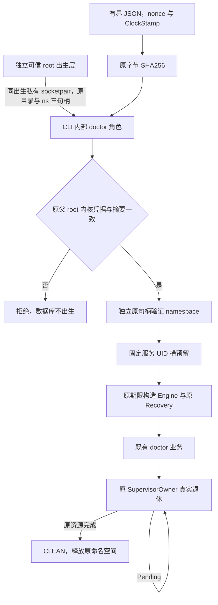

# Linux 监督 doctor 出生接线

状态：已接入 Engine/CLI 构造；d76ad70f 的 Linux ARM64 release 归档在隔离环境通过八场景构造验收。当前全量 CI 仍有夹具及 Windows 待核验项；公共 broker、原 child 全局容量寿命、私有退休确认和有限前端退出未完成，不关闭监督服务父项。

两个内部环境值只指定原启动 JSON 和唯一继承的私有 FD。环境自身不授予资格：JSON 原字节 SHA 必须由原父进程的真实 root UID/GID/PID 内核消息凭据确认，接收身份必须为已绑定的非 root 专用 UID。JSON 限4KiB，字段严格拒绝未知键，固定版本、不同服务/前端 UID、64位十六进制 nonce/摘要、绝对无别名定位与64MiB镜像上限。所有认证和身份失败在 Engine/数据库之前拒绝；既有普通本地入口保持兼容，配置内部角色后的错误绝不回退。

私有描述符须为已连接未命名 AF_UNIX datagram，拒绝 stdio、普通文件、stream 和其他 socket domain，采用后立即恢复 CLOEXEC。原 ClockStamp 采用两次扣除实际认证成本；之后构造仍取调用方原期限的较小值。namespace 及三原对象在预留、构造、出生前撤销和 SupervisorOwner 退休完整期间保留。root 出生材料指定镜像与数据目录，不采用旧环境镜像配置，客户端 argv 不得替换数据目录。内部角色当前仅接既有 `--json doctor`，禁止转交 serve 或其他命令。

root 内核凭据不代替固定 broker 的发行、镜像与生命周期信任。当前没有公共 broker、全局 bootstrap owner、退休私有确认协议或有限前端退出；仍等原资源退休再返回。不得把本构造组件称为独立服务已部署或恢复完成。本轮不安装桌面服务。

证据：`docs/benchmarks/linux_supervisor_birth_constructor/receipt.json`。旧0e90二进制在Linux隔离专用UID运行时忽略新角色标记，创建了数据库，为新协议缺失RED，不把它报告成旧CLI提权漏洞。八场景在旧二进制实际执行1通过/7拒绝失败，全部原child已wait、原容器已移除；此处只证明新协议缺失。共享解析真实RED1/2→GREEN3/0；macOS兼容host9/0、两包全目标Clippy通过。这些不编译Linux条件分支、不替代Linux验收。新增原生脚本对当前实际镜像完成CLEAN、ACTIVE、伪造角色、错误session、非root实际发送者、过期材料、错误镜像、数据定位替换八个场景；只有它在当前Linux源码构建后运行通过才能关闭对应子门禁。

## 5371e15 原生构造验收发现与修复

当前源码确实在Linux ARM64 CI编译并发布候选归档；独立核对checkout、原job归档摘要和实际归档后，在隔离root容器执行实际二进制。八场景结果为7通过/1失败：wrong_image同长度错误SHA仍成功创建数据库。原因是Linux可信内部ScanWorkerHost只保留预期材料，在扫描执行前才做sealed image校验，doctor未扫描，不能把Host构造当作完整镜像准入。

新监督出生路径在原held镜像上逐次读取剩余额度内的字节、完整SHA、dev/inode/length及纳秒mtime/ctime一致后才构造Engine；缓冲固定64KiB，原期限不刷新，EINTR重试仍检查期限，最终定位重绕同一File。最终路径打开加入NONBLOCK以避免普通文件检查前被FIFO打开阻塞。旧内部Host API保持兼容，不将该校验强加到其他可信本地调用。

新验证helper本机3/0、Clippy和格式检查通过，修复后的Linux原生验收仍待执行。原7/1失败及成功创建数据库的完整结果、实际原子进程wait和容器移除证据全部保留在`docs/benchmarks/linux_supervisor_birth_image_verification/`，不得称为8/8，也不关闭服务父门禁。

同一5371e15的三个Linux矩阵在Engine/CLI/MCP测试步骤失败，实际唯一失败目标为source_layout：两个新对象缺少现有门禁要求的“来源：”标记。原日志分别保留，补正文档而不放宽门禁，本机6/0通过；未把测试中预期的catch_unwind panic误判为失败。矩阵未运行到构造门禁，7/1证据来自该源码真实release归档的独立原生运行。

## d76ad70f 原生八场景与夹具保护边界

独立核对原 CI job 114404388500 的源码、归档摘要和实际归档，在不联网的一次性 Linux ARM64 容器中执行实际 CLI/worker。原生八场景全部通过，wrong_image 精确 Conflict 且数据库不出生；所有原 child 已实际 wait，两次容器均已移除。该结果关闭完整镜像验证与 doctor 构造的 Linux ARM64 子项，不证明公共 broker、异常 I/O 下有限前端退出或其他平台监督服务资格。

当前 CI 的 Linux 构造步骤返回 Unsupported。原 runner 祖先权限未记录，因此尚不能断定具体根因；在同一 d76ad70f 二进制、隔离容器中将 /opt 设置为 0777，原 /opt 夹具实际重现四个 Unsupported 失败。生产目录校验未修改。新夹具使用 /var/lib，先核对 /、/var、/var/lib 的 root 身份、真实目录类型与不可组/其他写，拒绝不安全祖先；显式设置本轮新目录权限，回执同时记录 /opt 权限。同一受保护夹具八场景通过。CI 上的新夹具仍需原生执行证明。

证据见 `docs/benchmarks/linux_supervisor_birth_protected_fixture/receipt.json`、原失败、隔离重现和新的 native_green.json；旧失败报告保持原样。

## 原 owner 与私有完成通知的绑定验收

监督通知接线必须同时持有同一 `SupervisorOwner` 与唯一私有 writer；只有原 owner 的实际退休返回 true 后才能写 CleanupComplete。原扫描预留、外部 Engine 引用、原恢复错误均不得产生完成帧；重复 Pending 轮询最多写一次 Pending，不能通过持续通知耗尽64帧预算。控制断线、取消或原控制期限耗尽不丢原 owner，也不得阻断随后真实资源退休；控制失败保持未确认，不能被本地容量 CLEAN 冒充为 broker 的完整确认。原控制期限不续期。本组件不认证对端，必须从已认证出生路径提供私有通道；未接入实际 CLI/MCP/服务时不关闭生命周期父项。

原通知绑定组件已实现：`SupervisorControlOwner` 独占持有原 owner 与私有 writer，`SupervisorControlProgress` 区分 Pending、真实退休且完成通知已写、真实退休但控制未确认。前台结束后不再借出 Engine，原 Arc/资源预留仍阻止实际退休；控制失败锁存，原恢复继续，最多四帧且原控制期限不续期。旧可信 raw encoder 接口保留，实际外部路径尚未接入新绑定，不能据组件通过宣称服务已安全上线。

基线回归真实 RED0/1（原预留仍 Pending 却能编码 Complete），新绑定 macOS ARM64 GREEN8/0，原 owner 回归9/0、源码规范6/0、全目标 Clippy和格式通过。证据见 `docs/benchmarks/supervisor_control_owner_binding/receipt.json`。夹具使用真实容量锁和资源预留，不执行 child；Linux/Windows 及实际 CLI/MCP 的私有出生与前台 EOF 尚待验收。不勾选服务父项。
