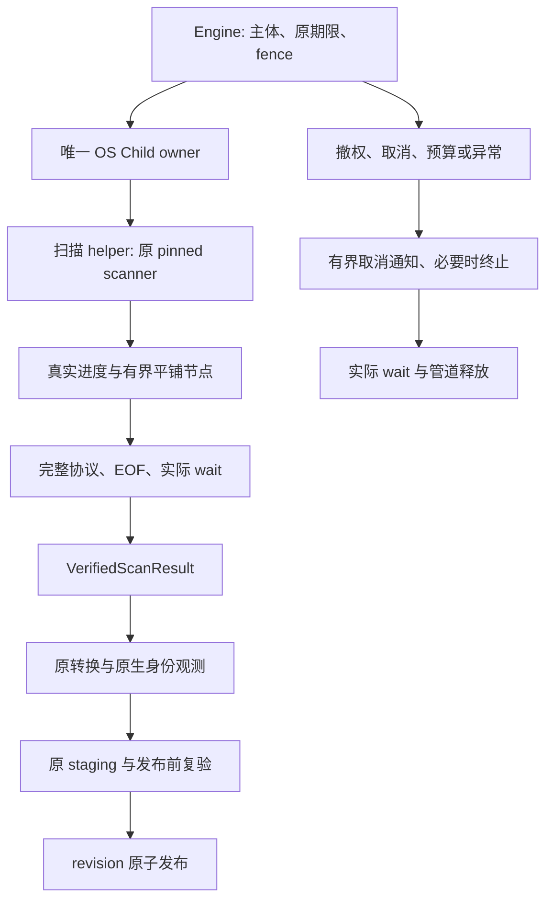

# 扫描进程真实退场实施阶段

本阶段继续同一变更的 PF-06、9.2、15.4 与相关资源／发布验收，不新建规格事实源，不关闭现有父任务。

## 源码依据与决定

固定上游 `ScanHandle` 丢弃实际线程句柄；结果发送后仍不能证明线程清理结束。上游还持有静态扫描线程池和 Windows MFT 释放线程。外层 Engine runner 的真实 join 不覆盖这些线程。

在三桌面系统将一次已成功认领的扫描放入受控 helper 进程。上游 pin、源码和14份摘要保持不变；正常结束必须完整接收结果、排空管道并实际 OS wait/reap。此证明是进程内扫描活动已停止，不承诺每个上游 TLS 析构优雅执行。

## 不变约束

- helper 不持有数据库、请求主体、token、owner 或 fencing；父 Engine 保留原 claim 时钟、20ms 检查、5s 续租及实时授权。
- 父端在原位置建立并保留 Linux/Windows 根与祖先身份租约。先保持准确绝对 root 与完整 ScanOptions，不用改变挂载排除语义的相对路径替换。
- 平铺记录迭代传输并保留原 Node 全部字段及子节点顺序；先检查帧长再分配，累计检查节点／深度／原始输出上界和完整 End。协议字节不是 staging 编码成本，不改变默认2GiB staging预算，也不双扣。
- 全字段与顺序保真指 **同一次实际 pinned 扫描交付的 Node 树**。上游 `aggregate_deduped` 在浅层并行聚合中用 `Seen` 先到者计费；同一 inode 的计费名称及其影响的大小排序不承诺在两次独立扫描间固定。不得修改上游或把所有 bytes／顺序字段全局忽略。跨扫描配对分层验收：唯一 inode 夹具的全部选项矩阵保持全字段／顺序精确；含别名且关闭去重时同样精确；开启去重时仅真实共享 inode 组的计费名称及其必然排序位置允许变化，仍须精确核对单份真实大小、唯一非零计费、每条路径身份及其余字段、父关系、根汇总和各次结果自身的 metric／name 排序。每次结果自身 codec 往返仍须全字段／顺序精确。
- 此澄清的证据边界：首次 helper／独立 pinned 配对实际出现不同计费名称，且与上述源码路径一致；后续固定八次 pinned 表征全部同次 codec 精确，但八次 **未观察到 winner 变化**。后者既不作为实际变化的证明，也不承诺跨运行确定性；不得重试直到得到希望的调度结果。
- 类型化帧必须拒绝未知 variant 与未知字段，包括无业务字段的 Cancel；公开 `Frame::Cancel` 的构造方式与 `{"type":"cancel"}` 序列化形状保持不变。真实有界 FrameReader 遇到未知 Cancel 字段应返回 InvalidData，并锁存该流失败，不得继续消费后续合法帧。此约束同时覆盖公开 codec 与独立 helper 执行协议，不以任一协议通过代替另一协议的验收。
- 业务结果、End、EOF、finished 或消息不能代替实际 OS 退出。正常 wait 不额外取消；异常／unwind 终止并回收，保留原错误及清理错误，不持数据库或 registry 锁等待。
- 正常回收还须确认自有组／Job 无活动；Unix 在此之前保留 leader，回收后禁止再操作旧数字 PGID。Windows 不以 leader 句柄 signaled 或 Job 句柄信号代替活动计数归零。现有 terminate+leader wait 不能单独证明整组退出。
- Linux 进程视图隐藏、权限不足、枚举截断或未知状态不能解释为空组。可信固定 helper 的不主动逃逸条件与观察资格须有明确证据；独立 session、两次快照或 PGID 本身不称为强沙箱，主动逃逸和源读取隔离继续单独验收。
- 共用 OS-child 层机械复用既有 Unix 保留 leader 身份与 Windows 启动前 Job／句柄 allowlist、非阻塞管道。原探针仍借原账本；扫描借自己的原账本，不伪造 ProbeBudget 或重新计时。
- helper 由受信安装／宿主配置定位并核验版本、架构及完整性，不查 PATH／工作目录、不下载、不允许远程工具提供 executable／argv，不隐藏退回 detached scanner。
- 物理退出不证明源读取隔离、云占位不下载、签名或设备能力；相应原生验收继续开放。同步内核清理可能超过业务期限，不承诺严格墙钟或 RSS 上限。

## 实施与实际验收顺序

原生启动器验收本身也必须保留物理清理证据。测试子进程建立独立 session 后，仅终止 Cargo 的进程组不能证明全部后代退出。Linux 隔离验收采用外层持有原 init child/pidfd 的独立 PID namespace：建立 namespace 和挂载隔离后，实际测试恢复为 runner 的普通用户身份，记录凭据、能力和 namespace 身份；正常、超时及中断路径均须实际回收该 namespace init 才能确认后代已退场。外层回收只证明验收环境清理，不能替代每个用例对原扫描 child/pidfd 的 wait 验证。无法建立隔离、回收尚未完成或原始错误被清理错误覆盖时，验收保持失败，不跳过、不以枚举 PID 或杀构建进程代替证明。

查询契约同时保留真实扫描和合法导入两种独立前置。导入夹具通过真实范围注册、公开 staging 及带实际 server/scope 的发布事务建立有限观测，随后执行相同的历史 revision、节点、跨范围拒绝和响应归属断言；不伪造 job 完成、租约或扫描回收证据。原有真实扫描用例继续运行，扫描资格不足时其失败不得被导入查询通过抵消。

1. 共用 Child owner：抽取现 OS 句柄／管道逻辑，保持旧探针全部错误与检查位置，补控制管道、正常回收和终止回收；执行原原生负控。
2. worker lib/bin：单向依赖 Core／pinned，不依赖 Engine／Store；有界平铺协议、真实进度、取消及全部扫描选项，执行真实 pinned 扫描配对。
3. Engine 接入：仅替换 walk/poll 段，结果须经实际退出许可后进入原转换、原生身份补充、staging 和原子发布；旧公开构造签名保留，受信 helper 配置为增量入口。
4. 打包与宿主：CLI／MCP／FFI 同版本 helper、安装 manifest 与真实宿主定位；缺失／错架构／篡改明确拒绝，不能把握手字符串当可信执行文件证明。
5. release 测量：20k／200k、宽／深目录及并发查询，报告父与 helper 的内存及采样合计、p50/p95、扫描时间、数据库／WAL增量；不以单个进程 RSS冒充整次扫描成本。

先以真实 helper 退出屏障验证：pinned 扫描结果已送达但 helper 进程仍活着，阻塞 result/drain 不完成；释放后真实 wait。屏障观察 helper 自身退场，不伪造上游 TLS。

再验真实扫描取消、撤权、预算、坏帧／早 EOF、执行失败与父 unwind：停止／回收、句柄与管道释放、零新 revision、既有错误语义。根／祖先替换及旧 leaf 移回仍精确拒绝发布，合法 sibling 活动成功。

与原扫描配对全部字段／顺序、硬链接、hidden、depth、links、one_filesystem、挂载排除及 Windows drive-root/MFT。平台未运行的行为、真实 provider、Swift/Kotlin owner 接入、Android/iOS 包／设备与签名保持未验收；桌面 helper 不替代移动 provider。

## Linux 固定 helper 的派生约束与真实线程退出资格（实施前合同）

普通进程组的动态 `/proc` 枚举继续单独验收，不能以两份相同快照宣称强沙箱。固定扫描 helper 可以采用新增的受限启动入口：在内部 fresh session 建立后、exec 前安装不可放宽的内核过滤器，拒绝普通进程派生和 session/group 迁移，保留 pinned scanner 所需的真实线程创建。旧探针和旧启动入口不偷偷继承新限制。

- 安装失败、未知 syscall ABI、线程条件不能可靠核验或缺少 pidfd 时明确拒绝，不回退到未受限 helper。x86_64 的 x32 syscall 编号不能绕过过滤；aarch64 使用对应真实 ABI，不假设不同平台的 syscall 编号相同。
- `fork`、`vfork` 与非线程 `clone` 必须实际失败；`clone3` 的兼容拒绝须允许 libc 的既有线程回退，并以真实线程扫描证明。拒绝 `unshare`、`setsid` 和 `setpgid`，不把当前源码没有调用这些函数当作内核约束证据。额外内核异步派生机制是否需要禁止，须有明确边界和测试。
- 受限启动与 pidfd 只能属于同一唯一 Child owner，成功建立过滤器的事实不允许客户端、协议字段或任意布尔参数伪造。正常完成仍须完整协议、双 EOF、控制端确实关闭、实际整个线程组退出与原 leader wait；主线程 `Z` 和 End 都不够。
- 真实反控必须使用进程 main 退出而其它原线程仍持续 heartbeat，观察 pidfd 尚未退出；自然释放之后才观察真实 pidfd 退出和 wait。不能使用救援 kill、模拟状态或刷新期限获得正常许可。
- namespace、hidepid、记录 overmount 等资格探针保留实际 errno 和阶段。能力不足输出 `QUALIFICATION_NOT_PROVEN`，不把测试框架的 return/pass 计为该原生能力通过。

该入口只约束固定 helper 的进程派生与会话归属，不证明文件读取隔离、云占位不下载、可信安装、动态装载环境或恶意特权宿主防护。只有原生 x86_64/aarch64 测试、完整扫描选项配对和父 Engine 接线验证通过后，才能声明本子能力完成；PF-06 及平台父任务仍依各自完整验收关闭。

## 父端组装检查点

完整 End/EOF 后的节点计数、子节点空间准备、合并与顺序恢复同样属于原请求执行期限。新增组装入口借用原请求检查函数，至多每 256 次节点或边操作检查一次，不刷新期限；取消或撤权保留原错误对象，不交付部分树，解码器失败锁存。组装中的深树必须由迭代清理 owner 接管，检查点失败不能触发递归 Drop。旧无检查点 codec API 保持兼容。单次分配、OS 调度与异常迭代清理不构成严格 20ms 响应或 RSS 上限承诺。

## Linux 首次握手前的原子进程身份

受限扫描进程在任何 child 握手之前就必须由父端持有内核绑定的原进程句柄。子进程自己打开 pidfd 后经 SCM_RIGHTS 回传，不能覆盖回传前外部终止的出生窗口，也不能作为此项完成证明。

- 使用内核原子返回 pidfd 的出生接口；限定 x86_64/aarch64 的真实 ABI。原生接口或策略拒绝保留原 errno，不通过普通 fork、数字 PID 再打开或未受限入口降级。
- 父端接管原 pidfd 后才允许分配、执行外部检查函数或进入可展开代码。Ready 前自然死亡、外部终止、初始化失败、取消及 panic 均以该原句柄终止/实际 wait；不得发送信号给可能复用的数字 PID。
- 多线程宿主的 child 分支只允许已审查的异步信号安全原生调用和固定栈状态；不调用分配器、锁、Rust 析构、宿主 handler 或 atfork 回调。信号 mask 恢复及 handler 重置按各原生 ABI 验证，不用当前 macOS 编译替代 Linux 行为。
- argv、环境、描述符和错误通道先准备；无关描述符关闭须有实际能力及错误验收。held ELF 按句柄执行，替换原路径不能改变实际执行镜像；此机制仍不单独证明安装内容可信或动态装载环境受限。
- 同一原期限与授权检查通过后才发送 ACK。Ready、错误通道 EOF 或成功 exec 不能代替完整协议、双输出 EOF 和整个线程组实际退出许可。

原生验收场景包含首 Ready 前外部终止与自然死亡、原句柄消耗后 ECHILD、其它活进程不受影响、多线程信号/atfork 负控、held 镜像路径替换、close_range 拒绝、出生接口拒绝以及两种架构的实际调用约定。独立 C 探针仅证明机制与环境资格；Rust 生产入口必须再次通过对应行为，不以探针成功或接口缺失编译失败宣称安全修复完成。无法实际制造 PID 复用时，该项单独标为未验证。

## 执行输入与扫描响应的独立字节账本

Request 与 Cancel 采用 helper 实际接收端相同的固定输入约束：单帧正文最多 1 MiB、累计输入最多 2 MiB。父端在序列化期间按该上限准入，不能用客户端选择的扫描响应额度扩大输入分配；Cancel 消费原输入剩余量。响应中的 max_frame_bytes/max_stream_bytes 字段及 stdout/stderr 共用账本保持原值，不能反向限制合法 Request 的序列化。回归分别验证大响应额度不能放行超大 Request，以及小响应额度不会提前拒绝符合输入合同的 Request。两者为序列化预算行为，不作为 OS 执行或文件路径资格证明。

## 原生失败的类型化传播

真实 OS I/O 失败在 Child owner 层保留原 io::Error 对象、ErrorKind 与 raw_os_error；复制错误状态共享原对象，不先格式化为文本再在上层恢复。原生主错误与实际清理失败分别保留，调用方检查点的业务类型不被清理诊断覆盖。原探针对既有字符串显示的兼容投影保持原内容，但不能把此显示投影作为新的扫描入口原生分类依据。验收以真实失败的 OS 调用和自定义原 I/O payload 检查 source 链、原码、原类别及复制后的对象身份；原探针分类与显示继续回归。

### 主错误与清理错误的产品分类

Engine 增量错误包装同时持有原主错误与实际清理 I/O 失败，不能用 secondary 覆盖主错误，也不能将组合误判为成功。CLI/MCP/FFI 的既有稳定错误码依据最内层原主错误分类；嵌套包装的 primary 解析采用借用迭代，不克隆或格式化业务错误。原 Business/Store/Io 对象、source 链及清理诊断保留；未发生清理失败时返回原 variant。用权限拒绝、预算超限、原 I/O 和存储失败分别验证三入口稳定结果，新增包装不扩大任何操作授权。

## 同版本 helper 包与安装清单

桌面只读 CLI/MCP 的构建、归档、私有包和 Linux 安装包必须携带同一版本的第三个可执行文件 diskgraph-scan-worker（Windows 使用 .exe），不能以库代码存在代替已安装 helper。bin 目录的 scan-worker-manifest.json 使用有限的 schema_version=1，记录 package_version、target、protocol_version=2、pinned_scanner_revision、scanner_source_manifest_sha256，以及固定 basename 的 executable.name/bytes/sha256。清单引用未修改的 vendored UPSTREAM_DIGESTS.txt；缺失 helper、清单不一致或复制后的摘要改变时包装与验收必须失败。清单不携带扫描 root、主体、token、argv 或宿主环境。

生成与验证程序只能在隔离构建/安装 artifact 上操作，拒绝目录、链接和未知字段，读取及哈希按固定块处理。读取期间文件身份、尺寸和高精度修改信息变化时拒绝生成完整摘要。清单是安装完整性材料；相邻可写 helper 与清单不能互相证明信任，未来 Engine 仍须由受信宿主的预期摘要或签名根锚定，校验实际执行镜像并固定平台装载环境后，才发送含 root 的 Request。Hello 与清单成功均不授予执行、扫描或发布许可。

验收分别覆盖真实归档包含三个 artifact、摘要/尺寸/版本/target/protocol/pin 一致，缺失及改写 helper 拒绝，以及原 stdio/HTTP/升级/回退验收保留。包装组成单元夹具不证明原生可执行能力；必须在原生 runner 用实际 release binary 复核。FFI 桌面 bundle 的 helper 定位和 Android/iOS provider 不由这组 CLI/MCP 包验收替代，父任务保持未完成。

### 受信宿主的已打开镜像材料

宿主入口接收独立可信来源提供的完整 SHA-256 与准确长度，并消费已经打开的普通 File；不得从邻接清单、远程请求、Hello 或显示路径自动建立预期值。预期配置字段不可由协议反序列化。核验最多接收128MiB镜像，按64KiB栈缓冲与剩余长度读取，原请求绝对期限和原检查点贯穿准入、定位、每次读取及末检；超限或未完整读完不得交付摘要。

核验前后比较实际句柄的完整身份、尺寸及高精度修改/change信息。Unix使用dev/inode及纳秒时间；Windows使用卷与128位file ID、creation/last-write/change时间，无法可靠捕获时拒绝。错误保留原类型与source，不从字符串恢复。成功材料唯一持有原File，不Clone；消费材料仍转移此File，名称替换不能使它重新打开另一镜像。

本入口只验证同一打开镜像的安装材料。后续原生启动还须保证真正执行该镜像（及从验证至执行期间的内容稳定、装载环境约束），并完成原子进程身份、EOF/实际退出及Engine发布门禁。材料返回不授予执行或发布，不作为平台父任务完成证明。

### Linux 执行镜像的密封副本

Linux 启动入口将原 held File 的实际读取字节复制到新建的 `memfd_create(MFD_CLOEXEC | MFD_ALLOW_SEALING | MFD_EXEC)` 镜像，并对同一批复制字节核验独立可信预期长度及完整 SHA-256。复制沿用128MiB上限、64KiB固定缓冲、剩余字节预算、原绝对期限及原授权检查点；比较原句柄读取前后的身份与高精度修改信息。不能先核验源文件再复制未核验内容，也不能重新按名称打开源文件。

交付前实际添加并通过 `F_GET_SEALS` 确认 `F_SEAL_WRITE | F_SEAL_GROW | F_SEAL_SHRINK | F_SEAL_SEAL` 全部成立。唯一密封 File 直接交给原子启动入口，通过原文件描述符执行；chmod、建议锁、路径前后 stat、Hello 或伪造状态不代替内核密封。创建、复制、摘要、身份、期限、授权或密封任一失败均禁止执行。此副本不证明动态装载器和系统依赖受信，也不承诺严格 RSS 上限；启动仍须约束装载环境并完成原有协议、进程回收及发布验收。

验收在真实 Linux x86_64/aarch64 覆盖名称替换、原地改写、读取期间源身份变化、原期限与原检查点错误传播，以及对成功镜像实际 write/truncate 被内核拒绝。未执行对应原生测试不能声明此能力完成，桌面父任务不因材料或类型存在而关闭。

执行资格另须显式申请 MFD_EXEC，与 CLOEXEC/ALLOW_SEALING 一起创建镜像；不依赖 vm.memfd_noexec 的默认值。旧的仅双旗材料验收只证明密封，不能证明可执行。创建返回 EINVAL/EACCES/EPERM 时保留实际原错误，不去掉执行旗重试，不通过 chmod 或名称启动绕过系统执行策略；EINVAL 本身不能区分旧内核与策略过滤。此能力拒绝不作为支持平台扫描成功的证明。

实际 ELF 回归须见证密封 A 镜像经原子启动和原 fd 执行；原名称替换为 B 后仍运行 A，B 独立正控须真实运行。执行不可用的 NX 副本作为真实拒绝反控。vm.memfd_noexec=0/1 的成功与 =2 的拒绝仅在独占、已核验身份的 namespace 中验证，不修改宿主全局策略；无法创建 namespace、降低父策略下限或写入独占策略时单列未验证，不能以跳过算完成。原绝对期限、双 EOF、原 pidfd 实际 wait 与异常 owner 回收仍适用；执行镜像测试不能替代动态装载环境及 Engine 发布资格。

### 协议额度错误的类型传递

父端真实节点、深度及声明总量超额由协议检查点产生明确类型，投影为 `BudgetExceeded`；普通 `InvalidData`、拓扑错误或含预算字样的文本不能获得该分类。helper 输出阶段的同类真实错误使用附加固定代码 `output_budget`，保留既有 Error 帧字段、`InvalidData` 类别、无 OS 码及原消息。新接收端继续接受原阶段代码；`output_budget` 必须在 Hello 之后且具有上述类别／OS 码组合，未知代码及伪造组合仍拒绝。旧接收端对不认识的代码保持拒绝，不把它解释为成功。

验收必须消费真实写端额度错误的序列化帧和父端实际解码结果，并由 runtime 使用集中类型投影；禁止依赖消息、泛化所有输出错误或只修内存测试。足额树、坏拓扑、普通输出 I/O、原 OS 错误码及清理责任分别保留对照；真实 CLI 的节点额度断言仍须经完整扫描宿主验证。

额度验收还必须覆盖真实原生树输出调用中的名称拥有前检查、节点／深度准备、帧正文及含头部的累计流字节限制；TreeState 的类型通过不能替代 FlatNodes、PayloadBuffer 或执行期 WorkerOutput 的验收。错误帧继续计入同一原始账本；字节余额耗尽或写端已锁存失败时，不得重建写端、重置额度或发送无界诊断以获取预算分类。真实下游写入错误及分配失败不能通过文本或宽泛 IO 类别伪装为额度错误。

序列化 sink 的首个真实追加失败必须独立锁存：即使自定义 Serialize 吞掉错误或返回成功，发布前仍返回该首错、保持输出与已完成字节账本不变，并拒绝后续帧。分配失败保持 Other/frame allocation failed，不改标额度错误；验收用真实单次分配拒绝和未武装完整输出对照。

执行请求的响应额度准入必须覆盖当前构建 target/pin 的真实 Hello 与六种固定额度错误中最大的完整终帧，包含两帧各自的四字节头部。单帧额度必须容纳其中最大的正文；累计额度必须容纳两帧之和。父端 `WorkerRequest::scan` 和外来请求 `into_scan` 共用实际有界编码检查，不足时在扫描准备前拒绝，不扩大四项原额度；输出端使用同一准备逻辑和原累计账本，直接提交已准备的 Hello，不重复序列化。

验收覆盖双入口的一字节不足拒绝、精确边界原额度不变，以及六种真实终帧与 Hello 在同一账本上的完整编码和解码。该准入不改变 Request/Cancel 的独立输入额度、通用解码器或既有非法请求在 Hello 前的 protocol-error 响应，也不保证任意长非额度错误消息均可写出；它不能替代原生进程启动、回收或 Engine/CLI/MCP 端到端验收。

### 失败时唯一进程 owner 的显式处置

启动或父端驱动失败后，主错误与真实清理失败分别保留。驱动配置借用调用者在 catch_unwind 外持有的唯一 child 槽，只有输入/输出/协议和原期限检查全部成功后才移交 owner。配置拒绝或 panic 不提前消费槽；调用者必须显式处置原 child，再保存主错误与清理结果。缺失 owner 明确拒绝，不按构造成功处理，也不以新增错误/owner 堆分配缩小返回类型。若终止或原 wait 未完成，错误返回必须同时移交唯一原 child owner；物理停止、EOF 和清理报错均不能冒充已消费 wait。不可只投影错误文本、舍弃 owner，或对数值 PID 重新打开/发送信号。移交 owner 仅用于停止与回收，不授予继续扫描或发布。

父端构造失败、协议/授权/期限失败和 panic 分别验收。检查点 panic 的原 payload 继续展开前，未完成处置的 owner 必须进入 catch_unwind 外仍存活的显式宿主处置槽；不得使用 mem::forget、无界隐藏全局 reaper 或替换 panic payload 充数。处置槽计入宿主有限活动进程容量，未完成回收不能释放槽位并无限启动新工作。清理拒绝需要实际 OS 反控；本机无法制造的条件标为未验证，不能用假布尔状态代替原生证据。

正常完成的许可保持完整协议、控制写端关闭、双 EOF、原进程/线程组退出与实际 wait。异常处置成功不转为正常完成；异常处置失败仍阻止 revision 发布。Linux 使用原子出生 pidfd 的原 owner，不能回退到旧 Unix/SCM 启动路径。

### 显式宿主与外部恢复句柄

保留既有 EngineConfig 字段及 Engine::open 签名。新增 open_with_scan_worker 消费受信宿主，返回 Engine 与标记 must_use 的唯一 ScanWorkerRecovery；宿主消费原 held File、独立预期摘要/长度及显式响应额度、stderr 子额度和非零有限进程容量。额度保持原协议语义，stderr 不得超过共享输出上限，远程请求不能配置执行镜像或扩大宿主容量。

恢复句柄须由实际 CLI/MCP/FFI 宿主保留在作业 catch_unwind 之外，直到实际回收全部原进程。Engine 的释放不能清空失败 owner；恢复句柄不可 Clone，不启动隐藏后台 reaper。occupied_slots 只报告占用数；drain 仅在全部原 wait 已消费且无预留/活动槽时返回 true，活动工作返回 false，真实清理失败返回原错误并保留同一 owner 与槽位。Rust 类型不能阻止调用方主动丢弃最终恢复句柄，此生命周期责任须由实际产品调用链和异常路径验收，而非仅靠 must_use 标记证明。

出生前先占用有限槽；失败且尚未实际 wait 的进程继续计入容量。

父端固定读缓冲的逻辑长度保持4096字节，实际分配在进程出生之前以可失败的预留完成；唯一 owner、空槽及错误返回只移动缓冲句柄，不内嵌或复制整块读缓冲。分配失败作为原 I/O/资源准备错误传播，不伪装为协议预算错误；出生后的 adopt 与 from_spawn 不为读缓冲新增分配。分配器容量及 RSS 不属于精确4096字节保证，控制写块的既有分配不因此宣称已移至出生前。
镜像复制串行访问唯一 held File，以原作业绝对期限下的有界 try_lock 等待保护共享文件偏移；等待继续执行取消、撤权和租约检查，不刷新期限。复制、启动、协议驱动和清理不得持有数据库或注册表全局锁。无受信宿主或缺少对应平台执行资格时，实际扫描明确返回 unsupported，不降级到进程内扫描或按未受信名称启动。旧 open 的查询及管理兼容性保留；此拒绝不是扫描能力验收完成。

CLI 与 MCP 的受信部署配置可通过服务启动时的本地环境给出 DISKGRAPH_SCAN_WORKER_PATH、DISKGRAPH_SCAN_WORKER_SHA256、DISKGRAPH_SCAN_WORKER_BYTES，三者必须同时存在或同时缺失。路径必须是绝对原生路径，摘要为完整64位十六进制，准确长度沿用镜像材料上限；非法或部分配置在启动阶段明确失败，不当作未配置。此配置不能从工具参数、请求头、相邻清单或当前工作目录补全；运维必须从独立可信安装来源提供预期值，而非对可写邻接文件自证。解析和打开只交付原 File 与不可变预期材料，不授予平台执行资格。实际产品宿主仍必须保留并处置恢复句柄；最终扫描成功须以配置过的真实安装 helper 完整链路验收。

MCP 二进制持有恢复句柄于协议 catch_unwind 外；结束或 panic 后先停止并 join 作业 runner，再在当前宿主线程实际 drain。处置失败保持原 owner，固定诊断只报告一次并等待后续处置，不丢弃句柄强制返回、不启动隐藏后台回收线程；永久 OS 回收失败可能阻止正常退出，必须单列运维限制。默认传输上界为每帧1MiB、共享输出2GiB、节点200万、深度4096、stderr64KiB，活动进程槽1；这些是独立传输额度，不从 staging 成本推导。服务克隆不复制恢复句柄，远程构造仍不引导本地管理员。

CLI 普通命令和 init 的独立数据库入口均在打开数据库前解析同一本地三值部署配置。命令操作在持有唯一恢复句柄的宿主内部 catch_unwind 中执行；普通错误和 panic 后均实际 drain，再返回原错误或继续原 payload。CLI 无后台扫描 runner。其传输字节/深度/stderr/槽默认额度与 MCP 相同，节点额度沿用用户 max_nodes_per_scan；staging 大小不改变传输字节额度。永久 OS 回收失败同样保留责任并可能阻止正常退出。

CLI serve 作为独立进程转交入口，在任何 CLI Engine 或 LocalIdentity 引导之前运行真实 MCP 伴随程序并返回其实际退出状态；不得先创建数据库、授予 local-user 管理员或通过 process::exit 跳过宿主生命周期。远程拒绝启动的真实伴随程序回归须验证数据目录未创建。普通 run/dispatch 不接受 serve 的内部误路由。MCP 的可信 stdio 引导和远程未认证边界由伴随程序原入口执行。

Windows 的伴随进程 ExitStatus 必须完整传递至已 join 工作线程的最外 main，保留原32位状态，不能转换为 u8 后返回（这会把低八位为零的错误变为成功）。此最外状态转交可调用 process::exit，但发生前没有 CLI 引擎 owner 且真实 MCP 伴随进程已 wait；普通 CLI 命令仍在全部恢复完成后返回标准业务 ExitCode。原32位状态的 OS 运行行为须在 Windows 原生环境验收，macOS 的退出6回归不能替代它。

### Linux memfd 策略 QA 的固定两阶段准备

本节只调整原六案的 QA 资格准备，不改变产品执行许可、镜像额度或 PF-06 完成标准。Linux 的 `memfd_noexec` 节点为0644，proc sysctl 的 DAC 按 GLOBAL_ROOT_UID/GID 判定；映射后的 userns root 与 scoped CAP_SYS_ADMIN 不足以通过该写入准入。依据 [Linux v6.17 pid_sysctl.h](https://raw.githubusercontent.com/torvalds/linux/v6.17/kernel/pid_sysctl.h) 与 [proc_sysctl.c](https://raw.githubusercontent.com/torvalds/linux/v6.17/fs/proc/proc_sysctl.c)，准备流程限定如下。

1. 普通 runner 在原外层绝对期限内完成精确 archive、来源摘要、构建和逐名 inventory，以及原 execution 两案、denial 一案。准备材料留在固定资格输出目录，供后续三个原 policy 案消费；此阶段只可报告三个已执行 case 和 policy 待执行，不能报告六案通过。所有 Cargo、C 编译和 runner 可写代码都以原非 root UID 执行。
2. 外层静态选择 scope0/1/2 与原精确测试名，每案创建独占新 PID1/private proc。该进程在永久降权前核实际 PID/proc/namespace 归属，只对固定 `/proc/sys/vm/memfd_noexec` 写入选定值并实读回；继承的父策略下限不允许降低，缺资格仍失败，不改宿主全局策略。此阶段不执行 runner 可写的 C、Rust、Python 或自由 argv；不存在长期 root broker 或可请求任意 sysctl 的接口。
3. 固定写读成功后，永久恢复原 runner 的 UID/GID/补充组，清除 effective/permitted/inheritable/bounding/ambient capabilities 并设置 NNP1。同一 PID 随后才 exec 固定模式脚本，再执行本次已逐名核验的 libtest `--exact`。原三个 Rust 测试正文不变；支持层必须核实际 PID1、私有 proc 的策略读数与 namespace、实际凭据及 capabilities/NNP，环境标量仅用于选择原案和传递绝对期限，不能代替这些见证。

普通准备入口使用 outer 内部固定 prepare 阶段，policy 选择只来自库内静态表。脚本模式不接受 root argv、任意可执行文件或任意策略路径。编译材料直到三个原 init 的 pidfd wait 与日志捕获均完成后，才由普通 runner 清理；任一主错与独立清理次错都保留，失败或未完成 wait 不计通过。外层原 pid_for_children 恢复及失败 owner 保留继续适用。

原整体最多30分钟的绝对期限与每 policy 案出生前建立的20秒绝对期限贯穿准备、namespace 写读、降权、exec 和测试，不在任何阶段重建额度。每案独立持有原 init/pidfd，超期后仍负责实际回收；结果累计必须实际为2+1+3，无 skip/retry 或缩减 scope。旧 C 特权初始化若退休，原源码与历史失败记录须按原字节保存，不能把旧缺资格错误改记为产品策略 RED。

验收先由既有 wrapper/qualifier 调用路径的纯行为合同暴露阶段缺失，明确模拟环境只证明编排。原生验收再独立确认 GLOBAL UID0 的独占写读、非 root/NNP1/caps0 实际执行、父策略下限、原 deadline 和每案 pidfd wait；生产扫描权限与动态装载资格不因该 QA 准备通过而完成。

## macOS 非特权进程派生限制的资格候选

在非 root 扫描 helper 上将 `RLIMIT_NPROC` 的软、硬限制均设置为零，须分别实测 `fork`、旧 `vfork` 入口和 `posix_spawn` 在相同入口的无限制正控成功后返回 `EAGAIN`；提高硬限制应返回 `EPERM`，实际线程创建、join 和原进程 exec 后的零限制继承必须通过。资格探针只在独立子进程改变限制，宿主限额保持不变。Apple Silicon 和 Intel 分别保存源码、二进制、编译器、SDK 和系统证据。

该机制不单独证明可信安装、镜像路径与加载器身份、提权阻止或完整扫描行为；不作为 Darwin `no_new_privs` 的替代。root 执行、缺少旧入口、任一正控失败或意外错误都保持未验收，不能跳过或重试取得通过。只有可信安装来源、跨重启准入及原 child/lease 生命周期都实现并验证后，才能接入生产扫描入口。

## macOS 安装声明与原生租约的准入合同

本节沿用 PF-06 可信安装与原 owner 要求，不以密码学子层替代平台扫描验收。独立可信宿主提供 Ed25519 公钥、非零 active epoch 及至多1024字节的绝对原生安装根；receipt 不携带可自授信任的公钥，CLI/MCP 的普通环境配置不得注册发行根或降低 epoch。可信发行方须在独占新版本目录中以 O_EXCL 创建从出生起未交给非可信 writer 的全新叶 inode，关闭全部发行写句柄后签发；现有文件 chown、时间戳或不可变标记不能证明此历史。活跃版本和祖先不得被更新替换；更新使用新 inode、新 epoch。

receipt 为至多16KiB的单一 JSON 对象，严格拒绝未知/重复字段、尾随数据及非64字节签名。claims 全部字段由严格 Ed25519 验证认证，签名消息域为 `diskgraph.macos.installation.receipt\0v1\0`，下列固定顺序编码：schema_version(u32)、installation_id(16字节)、epoch(u64)、policy_version(u32)、target、protocol_version(u32)、pinned_scanner_revision、image_sha256(32字节)、image_bytes(u64)、native_path、volume_uuid(16字节)、fsid(两个i32)、device(u64)、inode(u64)、birth_seconds(i64)、birth_nanoseconds(u32)、fresh_from_birth(单字节0或1)。整数均小端；target、pin、native_path 各以u32小端字节长度为前缀。JSON顺序不影响消息；原生路径字节不经UTF-8有损转换。

schema/policy固定1，protocol固定2，target必须为实际Cargo目标，pin必须为未修改的上游版本。epoch等独立宿主active epoch，安装ID和卷UUID非零，image_bytes为正且至多128MiB，摘要与长度均等独立可信预期；birth纳秒小于十亿，fresh声明必须为真。路径须严格位于可信根下，禁止NUL、点段、重复分隔符或尾空段。合法签名只认证发行声明，不直接授予扫描或执行资格。

原生租约从 `/` 的原目录句柄逐组件 openat/O_NOFOLLOW，保持全部祖先和原叶File；拒绝非root所有者、普通主体可写目录、setid、非普通叶、多硬链接、权限/ACL或卷能力无法可靠核验的对象。叶以 O_NONBLOCK 打开避免误开FIFO阻塞。逐个实际卷拒绝忽略所有权或非本地能力，不以重新按mount路径查找替代原FD。卷UUID、fsid、device、inode、birth高精度信息须匹配声明；完整摘要核验同时比较前后身份、长度、mtime/ctime、模式、所有者及ACL策略。固定64KiB读取块、原绝对期限和检查点贯穿核验，短EOF、多余字节或变化拒绝。

Darwin扩展ACL必须显式区分不存在与读取失败，卷能力有效性缺失返回unsupported；不得NULL即无ACL。首版允许拒绝所有实际ACL，或严格拒绝任何可授予写入/添加/删除/改属性/改安全/改所有者的ALLOW，不用DENY冲抵未知主体的ALLOW推断安全。ABI通过实际Apple SDK编译，不能猜测stat重定向或返回布局。

祖先目录在两次稳定捕获之间仅比较卷UUID/fsid、device/inode/birth及类型/模式/uid/gid；无关子项增删造成的长度、链接数与mtime/ctime变化不应失效已有安装。每次捕获仍重新核验原FD的实时ACL与卷条件，并保留单次 fstat→ACL→fstat 的完整前后元数据一致性检查，防止ACL采样后的权限竞态；叶子镜像继续完整元数据比较。并发目录变化落在单次捕获窗口时仍可拒绝，不承诺目录高并发下零误拒绝。

租约是私有、不提供File getter/Deserialize/Clone的原句柄owner，须在子进程出生的首个owner中附着，贯穿正常wait和catch外Recovery；在spawn返回后才附着或只留在Host中均不满足要求。目录句柄本身不冻结Darwin rename，可信发行方的active namespace不变合同仍必要。运行环境、非root限制与原完整协议继续独立验收。必须保存真实发行/跨重启准入、父路径替换、旧writer、目标竞态、撤销epoch和panic恢复证据；未通过时产品macOS扫描保持unsupported。

### macOS 公开出生接口与描述符准备边界

原生启动使用 Apple SDK 公开 posix_spawn、SETSID、CLOEXEC_DEFAULT、子信号mask/default属性和显式三标准通道映射；不使用宿主 pre_exec/fork 回调或私有SPI，不叠加SETPGROUP。保守平台下界为macOS 11，仍须实查原未回收PID的SID/PGID，不以旗标存在替代运行资格。argv和空环境固定，实际错误来自spawn返回值，不重新读取宿主errno。cwd及Mach-O加载命令/依赖闭包的安全性须由可信安装另外验收。公开spawn属性没有NPROC设置能力，helper入口限制不应称为出生时限制。

完整原owner在C调用前存在于Runtime catch外槽，包含预备管道、缓冲和Arc安装租约；C直接填原PID和group责任位，出生成功后的预备对象销毁次错不得篡改出生事实。原SID检查、检查点、panic及处置失败须保留该同一owner交给外部Recovery，不用局部Drop推断完成。

Darwin公开pipe/socket创建至CLOEXEC配置完成期间存在临时FD窗口。当前CLI/MCP受控运行期的管道准备和所有child出生必须使用同一短期出生协调门；等待沿用原检查点/期限，不持数据库或注册表锁，也不跨镜像哈希、协议驱动、wait或恢复处置持门。CLI serve在Engine创建之前分流并返回，属于生命周期隔离的启动例外。私有门不覆盖任意FFI宿主、第三方库、另一个链接实例或直接foreign fork/exec/spawn；公共Ops和vendored出生API未来接入产品必须先进入统一边界，不能宣称全宿主FD隔离。协调门现已覆盖原生通道准备、UnixChild受控启动和macOS原生出生；真实原pipe窗口并发回归与原取消/绝对期限回归已在本机通过。此组件不替代可信发行、加载依赖、helper限制及Runtime恢复验收，macOS产品扫描仍保持unsupported。

helper 的 macOS 入口必须在 FrameReader、stdin 请求读取、Hello 输出及 ScanHandle/控制线程创建之前检查真实/effective UID 均非零且一致，并安装与读取回验 RLIMIT_NPROC 的 soft/hard 零值；失败只写固定有界诊断后非零退出，不继续协议。该限制只在独立 helper 内改变，宿主不变；不替代 Mach-O 初始化期间与 setid 提权边界的另外资格证明。

macOS helper 加载命令准入从租约的原 image FD 用 read_at 读取；32字节头与至多1MiB命令区、至多4096命令受原期限/取消约束。首版支持当前架构独立64位小端 MH_EXECUTE/two-level 镜像，拒绝fat、flat namespace、环境命令、rpath、相对依赖、未知加载命令及非固定系统依赖；受信OS提供 dyld 与固定系统库，不从用户路径发现依赖。此命令策略不等于完整Mach-O有效性、代码签名或操作系统依赖闭包证明，仍需真实包/系统资格后方可启用Runtime。

macOS CLI/MCP 的活跃安装配置必须使用固定受保护位置，不能由普通环境变量选择公钥/epoch。配置读取与每次出生核验均从根句柄逐组件NOFOLLOW，检查全部祖先及叶root所有者/权限/ACL/local卷条件，以有界原FD读取并复核前后身份、内容长度及当前namespace；长驻Host必须重新取得活跃epoch，不能用启动时材料延长旧安装资格。可信更新者持久保存epoch下界并拒绝回滚；原生文件读取子层通过不能替代配置签发、更新及跨重启门禁。

可信更新者与扫描方共享固定永久root保护的 installation.lock inode；更新者独占锁，扫描方共享锁从最终活跃配置、镜像校验一直保留至原C出生返回及预备子端关闭。锁文件不随active替换、不从普通目录创建或环境定位；逐组件原句柄/ACL/卷核验、取得锁后再次核名称及身份。锁等待采用非阻塞flock、原期限/取消；本机互斥出生门不能替代跨进程安装锁。普通用户能读取锁文件时可能通过flock造成拒绝服务，等待须有界，不能声称抵抗同机恶意锁持有者；可信更新者不得绕过永久锁合同。

### 独立持久版本下限读取合同

固定 `epoch-floor.json` 与 `active.json` 分开保存。下限记录严格schema=1、非零epoch及规范化活跃配置SHA-256；规范化使用结构字段顺序的serde JSON，摘要域为 `diskgraph.macos.active-settings\0v1\0`。出生授权必须在原共享安装锁内读取两份保护文件，验证active_epoch、epoch_floor与独立epoch相等且摘要相等；缺失、损坏及新下限/旧配置均拒绝。JSON空白与键序不改变绑定，任何信任字段变化改变绑定。可信发布者必须先持久发布递增下限再发布匹配active；本读取实现不代替发布持久性及root夹具验收。

### 活跃安装代的运行与发布约束

macOS运行协议检查先保留原请求授权/取消错误，再读取同锁内独立floor和active；与Host原安装代不同必须走原driver处置及Recovery。发布必须在图库/控制库事务外等待共享安装锁，确认原安装代后跨完整revision事务保留守卫。原普通File宿主不提供此资格。产品启动资格仍须可信发行与真实平台闭环通过后启用。

### 首次可信安装与更新持久发布

首次布局只能由真实/effective root可信入口在固定系统位置逐组件NOFOLLOW验证后创建，仅创建DiskGraph/scan-worker目录及O_EXCL永久空installation.lock；已有inode不chown、chmod、truncate或替换，目录/锁必须允许普通运行UID读取遍历。创建失败保留安全残留，不能偷偷降级布局。新更新在同inode独占锁下建立新版本材料，校验独立镜像SHA/长度并关闭writer后签发；版本严格递增。独占staging材料须真实fsync文件/同设备目录，再由regular锚点F_FULLFSYNC确认此前同设备同步；任何不支持或错误均失败。版本下限先原子发布并持久化，随后活跃配置；中断不得回滚下限。ordinary隔离文件原语通过不替代真实root安装、断点恢复及CLI/MCP扫描验收。

## macOS 候选 Engine 产品闭环验收（未完成）

非默认 `macos_native_scan_candidate` 仅用于原生验收；默认产品能力须在全平台门禁完成后启用。CI 必须用固定 root 发行夹具安装 epoch 2，再以普通 UID 运行实际 Host→Engine→持久 job→staging→revision 路径，三个精确测试均不得跳过：成功发布两个文件共 8 字节、三个父子关联且 staging 被消费；真实出生后响应预算不足返回原 BudgetExceeded，任务失败且无 revision/staging；真实出生后 panic 保留原 String，外层 Recovery 清理后保留槽为零。检查点、期限、撤权及 epoch 检查继续沿原请求，不得用只检查时钟的回调替换。

普通 helper 完整树、原取消、原 panic 三项原验收继续必跑。冻结源码包含明确候选 feature、所有实际测试和锁文件；只编译、忽略测试或默认 Unsupported 不计完成。升级并发/发布末检、CLI/MCP 入口和最终同 SHA 全平台验收仍为独立未完成门禁。

## CLI/MCP 统一平台准入（未完成）

CLI 与 MCP 在创建任何数据库前，使用同一平台宿主解析入口和 30 秒绝对启动期限，首末检查沿原取消回调。macOS 不得把普通环境的路径、摘要与长度升级为安装信任；完整旧三值配置明确返回 Unsupported，部分或非法配置保留 InvalidArgument，不先打开旧路径。无旧环境配置时只从固定受保护 active/floor/receipt 解析实际宿主；完全未安装允许仅打开既有查询服务，但不得猜测执行路径或自行安装。Linux/其他现有显式配置解析兼容保留，平台执行资格仍由原生 launcher 决定。

真实 CLI doctor 与 MCP stdio 子进程必须证明旧完整环境配置在 macOS 被拒绝且 data 目录不存在；公开入口须同时验证原取消、启动期限、坏字段及未配置语义。受保护安装成功后的实际 CLI/MCP 扫描仍待独立原生验收，本段不以拒绝行为替代正向支持。

## Windows 原 owner 清理失败恢复（未完成）

Windows child 在实际 leader wait、Job 活动进程为零和 pending I/O 回收前不得标记 cleaned；TerminateJobObject、WaitForSingleObject、QueryInformationJobObject 或 I/O 清理错误必须保留可恢复的原 owner。原生回归须在真实出生后诱发一次可恢复失败，证明首轮错误传播、原 Job/process 句柄仍被持有、槽位未被释放；下一轮沿原 owner 实际观察清理成功后才能释放，不能用第二次幂等返回替代 OS 事实。出生后错误/panic 也必须由调用者 catch 外持有同一 child，并在恢复前保留原失败值。

Windows held 镜像租约、resolved NT 路由和实际 helper 扫描仍为后续门禁，当前九项镜像组件资格不替代该 owner 状态机或完整产品支持。

## Windows 跨线程 pending I/O 前置门禁（未完成）

唯一 child owner 可从执行栈移交给 Recovery；Engine 不得因此失去 Send。Win32 句柄采用标准库唯一所有权，保留非法句柄拒绝；OVERLAPPED 使用固定地址及内部可变内存，移交不移动内核仍借用的 operation/缓冲。最小 operation 可在审计后支持 Send，但不得支持共享并发改写，WindowsChild 不能以泛化 unsafe Send 掩盖字段约束。

真实线程 A 发起 pending read/write，线程 B 必须沿同一 handle/event/operation/buffer 地址取消并确认完成。GetOverlappedResult 在未知失败且 Internal 仍为 STATUS_PENDING 时必须保留 pending 及全部内存；Drop 也不得在未确认完成后释放。该安全前置需独立原生验证，随后仍执行原三个 cleanup RED，不修改其断言、不把编译错误视为清理问题已经复现。

### 2026-10-06 Windows 子层原生验收记录

冻结候选 d957e66 的 CI37384689462 实际编译通过：四项跨线程 pending I/O 通过，三项原 owner cleanup 恢复失败，保存原始 RED。修复候选 436ebea 的 CI37385193355 同七项测试实际全部通过，观察原句柄在失败后保留，原真实 wait/query 重试后恢复槽位才释放。该证据只完成上述子层行为验证；本节整体不关闭，出生后错误/panic 的外部唯一 owner、有限清理期限、可信镜像与产品正向扫描仍须继续验收。

### 有限清理与未完成恢复责任（生产门禁仍开放）

同一绝对清理期限必须贯穿 child、Job、管道 I/O 与资源槽；到期不能将取消已提交、leader 已退出或管道 EOF 当作完整回收。非阻塞清理仅在实际原进程 wait、原 Job 清空及原 pending I/O 确认完成后返回 Complete；Pending 或原错误保留同一 Job/process/event/OVERLAPPED 与缓冲。新入口可实现有限业务返回，但旧 cleanup/Drop 的阻塞兼容边界必须明确。

出生前已提交的 ConnectNamedPipe/ReadFile/WriteFile 也必须具有独立外部 owner，不能只覆盖 CreateProcessW 成功之后。Registry/Pool 返回未完成时保留原槽/目录代次；不复制 pending I/O 所属地址、不用 Drop/forget、隐藏 reaper 或无限同步复试代替实际恢复。目录同步删除也不构成严格墙钟上限。

最终 CLI/MCP 有限退出仍须有明确上层恢复生命周期：保留原业务结果/原 panic 与可继续处理的 Recovery。前端 OS 进程退出和库函数返回是不同门禁；未验证前不得宣称有限 shutdown 已完成。Windows managed runner 的调度准入只保护同一 Engine 的 runner/tick，查询仍独立，可信直接 run_job 及跨进程边界继续分别验收。

## 真实 MCP 回归的受控服务器生命周期（实现前合同）

原 MCP socket 查询、连接断开后任务完成及 legacy SSE 断言继续保留。测试服务的目录 owner 不能用扫描槽暂时为空代替 accept/连接/runner 已结束；测试断言 panic 后也必须执行同样的恢复顺序。

新增显式本地 HTTP 停止入口可保持旧 serve_config 签名兼容：停止只结束传输接入及原已接收连接，不撤销任何业务 job、不授予请求权限。停止责任由调用者在请求 catch 外持有，实际阻塞读取须通过原持有 socket 关闭唤醒，不能仅设标志并遗留线程。accept 与全部连接线程实际 join 后才能报告服务器结束，必须避免持有共享状态锁等待线程。原连接容量上限继续约束正在运行和待回收线程，不引入无限线程队列。

测试 runner 用明确 owner 在成功和 panic 路径 stop_and_join；源目录与数据目录保活至该责任结束，随后实际排空同一扫描 Recovery。所有原期限、授权、后台 job 和 socket 行为断言不放宽；未能完成停止/等待的用例仍失败。兼容等待不宣称 OS 单调用硬墙钟上限或 Windows 产品有限退出完成。

### 私有目录缺名的恢复责任（2026-10-06）

原私有目录的路径不存在不能单独证明原对象已删除：对象可能已改名而仍占用容量。缺少原对象句柄见证的兼容清理必须返回错误、保持 cleaned=false、原身份、账本和资源槽，不得把 NotFound 转为 Complete。根被陌生目录替换时不删除陌生对象；原对象恢复原名称后允许真实重试清理。该保守修复不能替代 Windows 原子创建并持续保留 root anchor、同对象 ReOpenFile 与逐项 handle-relative 删除的最终门禁，也不承诺路径核验与递归删除的竞态已经消失。真实改名和替换回归必须先观察失败，再实施修复；各平台原生回归通过前不关闭父项。

### Windows 私有目录原子 anchor 子层（尚未接入产品清理）

使用受信 held 父目录及单一原生 UTF-16 组件，通过 NtCreateFile FILE_CREATE 原子创建带原受保护 DACL 的根目录；取得有效句柄后，在任何状态投影/身份查询前交给 catch 外原 owner 槽。外槽非空拒绝；碰撞不收养原对象。NT 创建成功但身份查询失败可沿原 anchor 重新确认原父卷/目录身份；NT 失败带回句柄不可自动提升创建资格。

从创建起保留允许 READ/WRITE/DELETE 分享的原属性/枚举 anchor。ReOpenFile 只能作用于原 anchor，前后核原 FileID/卷，失败不得按路径回退。NtCreateFile→ReOpenFile 组合、原 shareREAD 目录租约及真实 managed Git cwd 必须通过实际 Windows 正控；普通目录和真实 junction 替换都不能被收养或修改外部 sentinel。此子层不执行删除，不证明增量 walker、Pool、Prepared I/O 或最终退出完成；原生单调用没有硬墙钟保证。

### Windows Prepared I/O 与出生阶段的实施约束

首次 Connect 提交之前，catch 外原 owner 槽必须已持有原 Job、父管道、event、OVERLAPPED 和 buffer。出生阶段明确区分 Prepared、Creating、ProcessOwned、CreateFailed；process=None 只在已确认未出生的状态允许无 leader，出生未知或已有进程缺 leader 不可伪 Complete。CreateProcess 失败也必须经原 Job0 与全部 pending 实际完成，不得直接 cleaned=true 并取走 owner。

I/O 种类明确区分 Connecting、Ready、Reading；Connect pending 的取消/完成不能被当作读取 EOF 或更新正常退出许可。原地址稳定且接收线程沿原句柄取消/查询；ERROR_NOT_FOUND 仅取消观察，仍须确认完成。新 Prepared 回归必须以真实 Connect 尚未完成为前置，验证到期、取消、panic、失败重试、原地址和容量，而不能用已有 read-pending 代替。旧 Null 四检查点、第三次非 Clone 错误、出生后 wait/query、三句柄继承及整 Job 正常退出原断言保留。

#### Windows 原对象重开原生 RED 后修订

Run 37400045249 的三个原正控在 ReOpenFile 返回 87，不能认定已可用。保持原命名测试、移动/junction/sentinel 和 managed Git/shareREAD 断言不变，改以创建时完整 128 位 File ID + 原 anchor 卷提示调用 OpenFileById；原 anchor 从创建到重开核验始终保活，新旧完整卷/身份/目录类型必须一致。无路径、64 位截断身份或不支持文件系统的降级；不获取 backup/restore 特权。共享冲突是失败并保留原 owner，不放宽原租约。新增原 shareREAD 子租约活跃时拒绝 DELETE 重开、释放租约后成功的实际原生回归。此 API 子层通过仍不等于已完成目录删除、Pool 或产品退出。

#### macOS 创建门与旧生命周期回调

旧可信本地 UnixChild Null/WorkerControl 的 checkpoint 保留出生前/实际出生后两阶段语义，创建门竞争不能把出生后回调提前执行。新增独立 admission 检查用于等待门时的原期限/撤权/取消，不能用生命周期次数推断请求授权状态。实际授权探针必须使用含 admission 的入口并借用同一原预算；兼容本地入口可以等待短创建临界区，不宣称严格墙钟期限。正常生产原生 launcher 保留已有的原请求绝对期限。确定性的真实门竞争回归、原错误身份/真实清理、旧两次检查、等待撤权无出生必须均通过；禁止将全套回归强制串行来隐藏争用。

#### Prepared Job/I/O 原外槽阶段

WindowsChild 在首次 Connect 提交前把原 KillOnClose Job、空管道槽和明确 Prepared 状态安装到 catch 外 owner。stdout/stderr/control 首次 Connect 的稳定 operation/event/buffer 均在原 owner 子槽中；任何准备错误/panic 不消费 owner。阶段 Prepared/Creating/ProcessOwned/CreateFailed 显式区分，只有 Prepared 或原 CreateProcess 明确失败允许无 leader 的终态判断；Creating 或 ProcessOwned 的缺失 leader 永不当作 Complete。原 CreateProcess 失败不能 take owner 或设置 cleaned；须实际观察原 Job 活动零与全部原 I/O 完成才能释放容量。出生后缺失 stdout/stderr 同样不能当作空管道成功。

保留原 Null 四检查点、第三原错误、born 查询/wait、三继承句柄、正常整 Job 终态测试。新增真实 Job+pending Connect 期限/容量、原 Job 查询错误重试、pending 后 panic、未知创建阶段缺失 leader 的 fail-closed 状态故障，以及真实无效 cwd 的 CreateProcess 失败不丢 owner。状态故障不声称真实发生未知内核创建结果。旧同步管道准备/cleanup/Drop 可阻塞，完整产品有限出生调度仍未完成；本阶段不启用 Windows 扫描 launcher。

#### Windows 产品探针创建等待 admission

WindowsChild::spawn_into_with_admission 分离原请求预算检查与四阶段生命周期。stdout/stderr Connect 只用 FALSE 查询，在每次竞争前及完成后复查原 admission；控制连接沿同一 admission。Windows 产品探针通过 RefCell 依次借同一 ProbeBudget 进入新接口，账本、绝对期限、撤权/取消不复制或续期。兼容 spawn_into 仍是无等待期限的可信本地入口。新增真正 pending Connect 在原 deadline 退出且保留原地址/Job，以及出生前/管道已准备的取消不推进生命周期。原 Null 四阶段回归不得改弱。原生单调用及旧 cleanup/Drop 不承诺硬期限；产品最终退出的有限清理调度仍待接入。

### Windows 产品探针到期后的清理转交验收

产品 execute 必须用原 ProbeBudget 的绝对期限驱动非阻塞清理；期限到达时 Pending/Err 保留原 owner 并转交原预留 recovery 槽，不通过兼容 cleanup/Drop 继续无限等待。不得重建预算或延长期限。真实出生回归在原生命周期钩子内耗尽原预算，证明有限边界不消费旧 wait 故障钩子、原 Job/容量仍保留；卸除钩子后必须沿同一 owner 实际回收并确认 Job0/leader。旧源码须在同一确切断言上产生 RED，编译/未出生/无关失败不计证据。此条不关闭目录 walker、Pool 最终退出或单次 OS 硬时限父项。

### Linux 扫描名称复核的临时解析竞态（12f4551 复现）

原始 run 37541399150 / artifact 11449342615 的 200000-wide-round2-candidate 在 openat2 名称复核返回 errno=11；扫描失败且未发布节点。EAGAIN 不足以证明缺少平台能力。仅扫描 namespace 的打开/复核可对原生 EAGAIN 最多尝试 8 次，保持完全相同的 parent、name、flags 和 resolve；每次前后执行原授权、取消、期限检查，不创建新预算。持续 EAGAIN 返回 Conflict，不能发布；其他 errno 不重试，符号链接和祖先替换的拒绝行为保留。typed io::Error 必须在失败现场取得，不依赖后续 last_os_error。

验收：瞬时错误后真实受约束打开可成功；持续竞态有限失败；等待期间撤权/取消/超时停止；其他错误立即返回；成功后检查失败必须丢弃句柄。策略单测与 Linux 真正 openat2/名称替换测试、20k/200k 配对扫描门禁分别记录，不相互替代。原始失败 ZIP 应保持可追溯。
