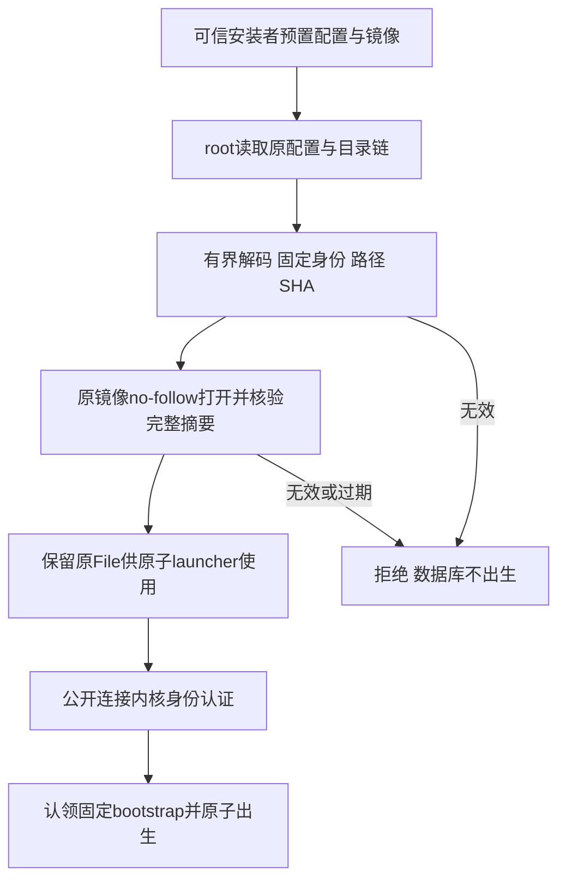

# 独立监督服务的固定安装配置

沿用PF-06及已有三平台独立服务授权。本增量先落实Linux产品broker的安装准入，不更改250ms数据库、50ms能力和原30秒启动期限，不安装桌面服务。

## 可观察验收

- 安装配置只能由可信安装者预置；JSON最多4096字节，schema固定1，拒绝未知和重复字段。
- 固定前端UID与专用非root服务UID必须不同；服务UID/GID不能为0或无效UID。请求不能选择镜像、身份、状态域、数据目录或socket。
- 路径必须为绝对规范安装路径，拒绝NUL、`.`、`..`、重复分隔符及过长路径。数据目录必须位于固定状态域内，socket长度须满足Unix原生上限。
- CLI和worker完整SHA256采用64字节小写十六进制；只解析配置不签发镜像信任。
- 执行时root逐组件no-follow打开安装配置及镜像，祖先root所有且组/其他用户不可写。普通文件单链接、root所有且不可由组/其他用户写入；镜像具执行位。
- 保留已核验的原镜像File，固定64KiB缓冲核对完整摘要，核对前后原身份、长度和高精度ctime/mtime；期限到期、内容变化、摘要不符拒绝，不能创建Engine或认领bootstrap。
- 安装配置解析和镜像准入不等同完整broker、真实Pending恢复或三平台服务验收。当前父任务保持开放。

## 顺序

公开连接、bootstrap域、broker二进制、安装升级回滚及其他平台服务仍需产品接线和原生验收；不因本增量通过而勾选整体生产门禁。
