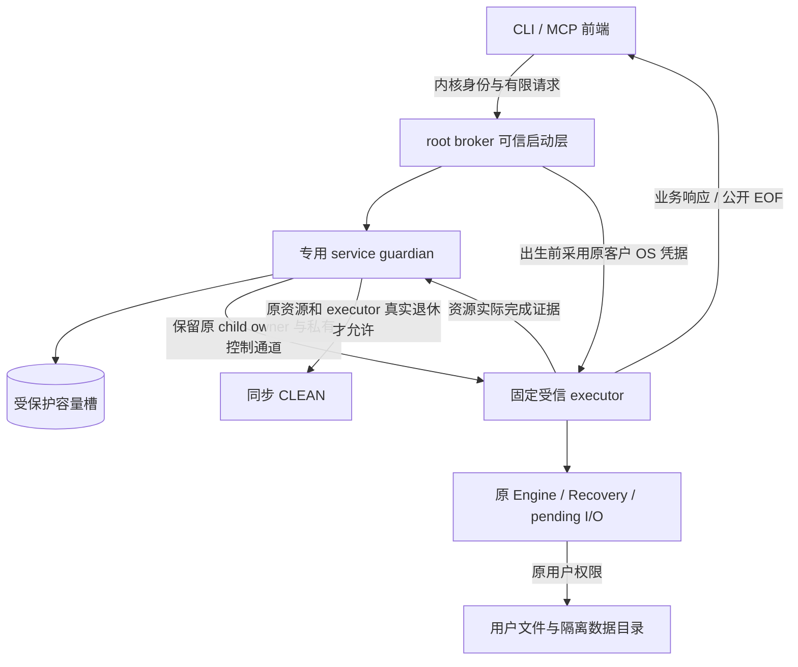

# 监督产品接线的 OS 权限保真审查

状态：2026-10-12 用户已批准 guardian＋用户 executor 职责调整，保持完整只读范围；产品接线与三平台验收尚未完成。事实源仍为 implement-diskgraph-platform。

## 当前缺口

frontend_recovery_supervisor.md 的已确认 Linux 纵向链让专用 service UID 的监督直接持 CliEngineHost。当前 CliEngineHost 未提供原客户完整 OS 凭据执行边界。因此专用服务 UID 与前端 UID 分离虽然阻止前端伪造持久槽，却不能证明用户0700目录/0600文件的读取语义保真；服务身份自身权限也不应变成客户权限。doctor 无文件读取的启动验收不能证明此项。独立架构审查对作为全功能生产方案的直接接线给出 BLOCK，已有槽库组件继续有效。

## 已批准职责调整

root只承担启动及身份配置，业务读取前降权；不使用root Engine或DAC绕过能力，不要求用户修改文件权限。原Engine/Recovery/pending缓冲始终保留在最初executor地址空间，guardian不接收序列化owner。同UID进程不能通过伪造完成消息清槽。

客户凭据须由可信启动层获取并绑定UID/GID、有效辅助组和适用安全上下文，不能信任客户字段。镜像完整性、反同UID注入、白名单继承、私有IPC、原child/resource owner与异常死亡保持未确认是实施前置。MCP token主体与OS执行身份分别绑定；应用授权仍取token与实时数据库权限交集。

验收必须覆盖：用户0700/0600可读；仅service可读而用户不可读的路径拒绝；辅助组/ACL/链接/非UTF8语义；前端退出和EOF后原executor仍恢复且槽占用；实际资源退休后才清CLEAN；异常死亡不释放容量。三平台各自验证，不以Linux容器替代macOS/Windows。

其他候选是服务内可靠凭据模拟，但需要线程、异步任务、子进程和组权限全面隔离。临时fsuid不作为未经验证的跨平台方案。职责分离是推荐方向。本文不授予安装桌面服务，不声明这些机制已经实现，不勾选生产任务。

## 原生隔离权限事实（2026-10-08）

脚本scripts/probe_supervisor_os_permissions.sh及Rust helper在固定digest的一次性Linux ARM64 root容器中实际执行六场景。每次降权后的真实euid/egid/groups全部匹配，正向内容为synthetic，负向精确EACCES(13)。覆盖用户0700/0600和服务0700/0600的双向拒绝，以及第三方组0750/0640：仅UID/主组不可读，保留原辅助组后可读。原日志、源摘要见docs/benchmarks/supervisor_os_permission_probe_2026_10_08。任意非零即拒绝的旧探针明确superseded，不能代替精确断言。shell语法检查和diff检查通过，双路复核APPROVE/CLEAR。

此证据验证OS身份保真需求，不验证产品凭据获取、绑定、注入保护、ACL、guardian/executor接线或三平台；职责调整现已批准，原生探针不据此升级为产品生产验收。

## Linux 同 UID 环境材料保护的候选实测

2026-10-12 在已有 Linux ARM64 镜像的无网络、只读、临时 exec tmpfs 容器运行实际 ELF 夹具，未安装工具或桌面服务。Root 父进程只保留 SETUID/SETGID，打开原镜像后子进程降至23111、清组和能力、设置 no-new-privileges 与不可转储，再执行原FD。真正exec后的普通0555镜像 dumpable=1，同UID邻进程可读取 synthetic 环境标记；root所有的0511镜像 dumpable=0，邻进程打开环境精确EACCES(13)。两例的原ELF子进程及观察进程均由原父wait确认退出。

此边界的依据包括 Linux 内核 `would_dump` 对执行者无读取权限的镜像设置 ENFORCE_NONDUMP：[原内核源码](https://linux.googlesource.com/linux/kernel/git/torvalds/linux/+/79ba234b396b0fdcb3a82dd8aa872348f4069aae/fs/exec.c)。实测 kernel_suid_dumpable=0；不能把此结果外推至其他内核配置、macOS 或 Windows。

仅在exec前调用PR_SET_DUMPABLE不是已验证的完整保护。0511允许root原镜像摘要读取而不增加DAC绕过能力，但客户身份自身不能重新打开worker读取摘要，产品需通过root出生时传递的原已核验镜像FD完成，不能忽略摘要检查。原根身份、辅助组、安全上下文、私有FD、命名空间、guardian与原owner/资源退休仍须整体接线验收；本次只证明候选exec边界，不改变当前专用service UID业务角色、不启用MCP转发、不关闭生产父项。

夹具与实测回执见 scripts/fixtures/linux_executor_dumpability.c 和 docs/benchmarks/linux_executor_dumpability_2026_10_12/。最初0111输入使去除DAC能力后的root父无法读取镜像，是夹具输入错误，已记录；不把它称为业务RED或产品漏洞。

## 已批准方案的首批身份组件（2026-10-12）

验收新增：连接身份读取必须使用内核保存的原Unix连接凭据，包括完整辅助组；拒绝账户组数据库、客户端字段和PID路径推断。executor出生前安装原辅助组，guardian旧入口保持零辅助组。非法组数组必须在clone前拒绝，setgroups失败仍由原pidfd owner回收，不以Ready代替真正exec。

LinuxFrontendConnection现保留SO_PEERCRED/SO_PEERGROUPS不可变快照，组长度最多Linux NGROUPS_MAX的65536项，先读取长度再分配实际数组；不支持或长度异常拒绝，不降级为空组。LinuxSupervisorLauncher新增使用该快照的executor组件准备入口，原prepare仍清组。原C出生ABI扩展组数组，Rust及原owner测试镜像布局同步更新，数组只由受信父侧保留到clone完成。该入口尚未接通产品executor。

原生产setgroups(0)在新真实exec夹具中丢失两项受信组，角色退出3；原pidfd仍确认退休。修复后Linux ARM64隔离容器13场景通过：两组实际保留、guardian零组、非法数组出生前拒绝、setgroups拒绝时原owner回收、原pidfd信号与wait。x86_64只完成严格交叉编译；原生Rust连接快照与launcher尚待新CI，不能用C实测代替。回执见docs/benchmarks/linux_executor_groups_2026_10_12。

内核依据：[Linux v6.12 sock.c](https://github.com/torvalds/linux/blob/v6.12/net/core/sock.c)，两项socket选项均从连接保留的sk_peer_cred读取。此快照只证明Unix DAC身份，不证明LSM执行上下文或PID寿命；有效GID为0的executor仍受旧出生组件拒绝限制。真正guardian/executor责任分离、私有worker FD、LSM/ACL、同UID注入保护、完整CLI/MCP及三平台服务接线仍未完成，不勾选生产父项。

### 原资源与容量职责拆分的验收

executor资源owner只持原Engine、原ScanWorkerRecovery及Windows原ProbeRecovery，不持容量槽或CLEAN能力；原Engine存在外部引用、真实预留仍占用或原池恢复失败时均不得报告资源退休。绑定错配时整体返还原材料，不封闭任一池。现有SupervisorOwner组合该资源owner与原ActiveSlot，保持既有本地接口、先封闭两个池、实际资源完成才清槽的行为。独立guardian必须另核实原executor进程退休，资源owner单独返回true不能用作跨进程CLEAN证据；本次拆分不授予该跨进程能力。

已实施ExecutorParts/ExecutorResourceOwner，并在现有SupervisorOwner中复用真实退休逻辑。对应对象归入supervision目录，mod.rs仅声明与重导出，原crate根公开路径保持兼容。4项新增真实资源夹具、47项监督回归、6项源码规范及Engine all-targets Clippy通过；API RED是新类型缺失的编译错误，未称作运行时行为失败。

本机完整Engine/CLI/MCP尝试未通过：99个测试二进制汇总1227通过、370失败、23忽略，30个目标失败。固定macOS root安装目录不存在，driver镜像未配置，原日志包含显式前置条件失败及Unsupported；未穷尽归因，不能据此宣称没有其他问题。未安装桌面服务或修改固定安装。原始日志及源码摘要见docs/benchmarks/executor_resource_separation_2026_10_12，资源拆分后的三平台完整CI仍待运行，产品跨进程接线仍未完成。

### 原worker句柄交付验收

root出生层可在固定FD7交付原已核验只读worker句柄，不接受客户FD或路径；guardian旧七FD出生仍保持原白名单。worker句柄必须与七项出生材料互不别名，出生前拒绝低FD或错误访问模式。受信材料包含FD7选择并绑定原JSON摘要，接收方恢复CLOEXEC、核对原普通文件和独立完整摘要，不通过worker_path重新打开。旧版本无此字段保持原受信路径兼容，未知版本或其他FD号拒绝。

真实exec验收：root只读镜像路径对降权角色精确EACCES，原FD仍可读取完整预期内容；额外FD均关闭，原pidfd实际wait。角色读取失败不能伪造完成。此交付只给固定worker镜像，不给业务文件DAC绕过能力；用户executor、镜像隐私和LSM仍需整体准入。

## 生命周期通知耗尽本轮期限的验收补充

版本2的真实资源退休和通知共用有限轮询期限。当资源仍Pending且本轮期限已耗尽时，不得开始新的通知尝试或永久锁存发送超时；下一轮由调用方提供新的有限期限后，沿用原会话和序列发送。原版本1固定期限不刷新，控制取消和已开始发送后的失败不得重试。资源已退休后也适用未开始通知的延后规则，未发送完成帧不能返回Complete。此补充不增加公共请求预算，不代替原child接收和wait验收。

### 用户executor镜像出生权限验收

用户executor出生材料显式选择隐私保护，普通guardian零标志兼容。真实UID/GID/辅助组和零能力采用后、Ready之前，使用原held ELF和faccessat2的AT_EMPTY_PATH/AT_EACCESS检查读取权限：只有精确EACCES才允许exec，可读镜像或不支持系统调用均拒绝。随后设不可转储，避免ACK等待期间暴露环境。固定root安装镜像及摘要信任仍由原宿主保证；完整保护必须另验实际exec后的dumpable与同UID邻进程读取拒绝，不能仅靠此组件关闭三平台生产任务。

该保护已接入prepare_user_executor的原出生材料，普通prepare保持零标志；原ABI仍80字节，Rust和C固定偏移同步。实际旧C允许可读镜像exec，回归RED为driver退出42且原pidfd已wait；修复后Linux ARM64隔离22场景通过，包含可读镜像拒绝、0511真实exec后dumpable=0、实际客户ACL读取许可确认后拒绝、faccessat2 ENOSYS拒绝和原组/句柄/wait回归。tmpfs不支持ACL的errno95保留，转到一次性容器overlay后实际ACL验收通过。x86_64仅严格交叉编译；Linux Rust产品路径、三平台、完整guardian接线仍未验收。证据见docs/benchmarks/executor_image_privacy_2026_10_12。

### executor控制通道接线验收

原私有控制owner增加显式executor入口，输入只含ExecutorResourceOwner与已认证原writer，不接收ActiveSlot。实际预留未回收时必须发送Pending且保留原资源；实际完成后唯一完成帧不读写guardian槽，槽仍ACTIVE且不能被再次认领。原兼容监督入口及固定/生命周期消息规则保留。该接口不签发认证、不证明跨进程收到帧，不据此释放全局容量。真正guardian须进一步确认原pidfd进程退休，三平台出生与前端接线仍需验收。

已实施SupervisorControlOwner::for_executor，内部退休责任分别保持原兼容SupervisorOwner和无槽ExecutorResourceOwner，消息状态机与原writer不复制。新增真实资源/槽测试确认：预留仍占用时仅Pending，原资源完成后唯一Complete，guardian原槽仍同步ACTIVE且外部认领返回Busy。11项控制回归、6项源码规范及本机Engine Clippy通过；API RED是E0599接口缺失，不称运行时行为RED。原进程出生、guardian wait、Windows控制路径与跨平台产品验收仍未完成。见docs/benchmarks/executor_control_separation_2026_10_12。

### exec后隐私收敛与内核策略验收（2026-10-12）

source27fe83c8的三项Linux原生出生验收均在executor_private退出9，真实exec与原pidfd wait成功；原失败未记录实际非0值，不能推断已证明其为2。新验收必须记录实际fs.suid_dumpable和exec后状态。Linux内核区分0与2的受保护模式和不安全的1；依据docs.kernel.org/admin-guide/sysctl/fs.html及Linux v6.12 fs/exec.c、fs/proc/base.c。

不得通过允许任意非0值或只改变验收断言修复。受信出生层在创建用户executor之前只接受内核策略0或2，1/未知/读取失败拒绝。原客户读取镜像精确EACCES仍是前置。受信executor入口在任何Engine或会话初始化前只允许原受保护状态0/2，并主动设为0且复核；发现1拒绝，不能把已暴露状态事后伪装成安全。验收增加同UID独立观察者，exec后归零之前和之后打开原environ均精确EACCES，原角色及观察者均由其原父wait。仅策略0/2分类单测不能代替实际内核2验收；不写宿主全局sysctl，不安装桌面服务，目标平台接线未完成仍保持未完成。

本次本地隔离Linux ARM64共25个C场景按预期通过，其中denied_groups预期driver42并保留原wait证据；独立同UID观察者在实际exec后收敛前后读取environ均精确EACCES。实际内核策略为0；模式1的真实普通入口拒绝已验，内核策略1只完成分类与读取拒绝单测，不能冒充修改内核后的实测。x86_64只完成严格交叉编译。Engine Clippy、6项源码布局、项目指定范围fmt及OpenSpec strict通过，vendored源码未修改。证据见docs/benchmarks/executor_privacy_seal_2026_10_12。

source27fe83c8 CI38186034323已终结：20成功、3失败、0取消。macOS/Windows完整矩阵和五项原生包通过，三Linux失败只位于executor_private原生C验收；Linux真实CLI/stdio/认证HTTP及原doctor监督构造步骤通过。这些是原source的证据，不证明本次修复或完整guardian/user executor接线通过；实际策略2与新的Rust Linux入口仍待新CI。原终结日志/夹具/作业状态保存在docs/benchmarks/ci_27fe83c8_terminal_2026_10_12，不勾选生产父项。
