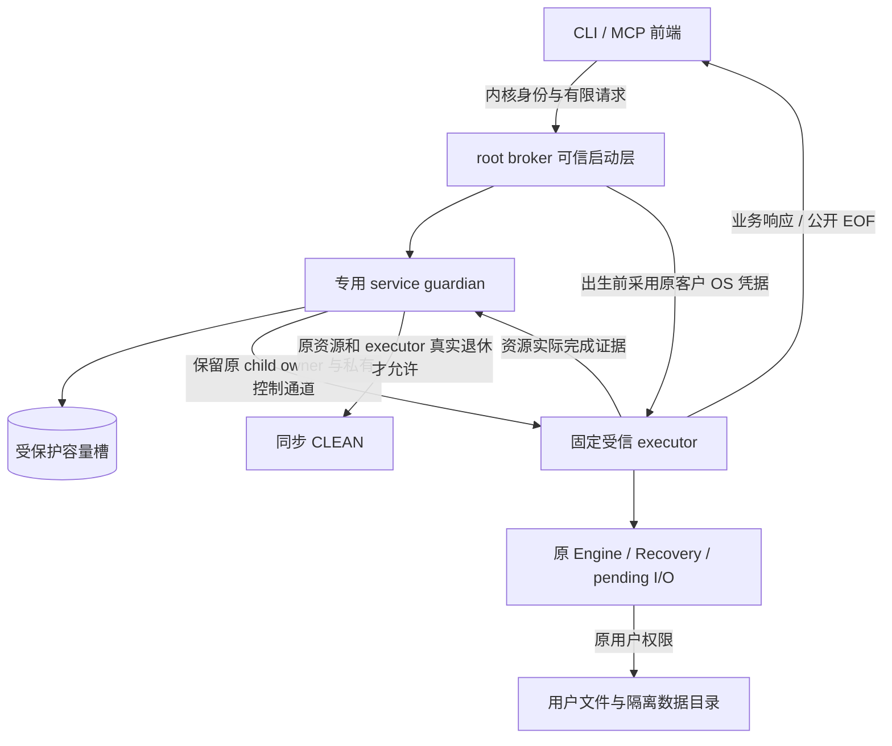

# 监督产品接线的 OS 权限保真审查

状态：架构审查与待确认职责调整，尚未实施，不替代现有验收。事实源仍为 implement-diskgraph-platform。

## 当前缺口

frontend_recovery_supervisor.md 的已确认 Linux 纵向链让专用 service UID 的监督直接持 CliEngineHost。当前 CliEngineHost 未提供原客户完整 OS 凭据执行边界。因此专用服务 UID 与前端 UID 分离虽然阻止前端伪造持久槽，却不能证明用户0700目录/0600文件的读取语义保真；服务身份自身权限也不应变成客户权限。doctor 无文件读取的启动验收不能证明此项。独立架构审查对作为全功能生产方案的直接接线给出 BLOCK，已有槽库组件继续有效。

## 建议职责调整（待确认）

root只承担启动及身份配置，业务读取前降权；不使用root Engine或DAC绕过能力，不要求用户修改文件权限。原Engine/Recovery/pending缓冲始终保留在最初executor地址空间，guardian不接收序列化owner。同UID进程不能通过伪造完成消息清槽。

客户凭据须由可信启动层获取并绑定UID/GID、有效辅助组和适用安全上下文，不能信任客户字段。镜像完整性、反同UID注入、白名单继承、私有IPC、原child/resource owner与异常死亡保持未确认是实施前置。MCP token主体与OS执行身份分别绑定；应用授权仍取token与实时数据库权限交集。

验收必须覆盖：用户0700/0600可读；仅service可读而用户不可读的路径拒绝；辅助组/ACL/链接/非UTF8语义；前端退出和EOF后原executor仍恢复且槽占用；实际资源退休后才清CLEAN；异常死亡不释放容量。三平台各自验证，不以Linux容器替代macOS/Windows。

其他候选是服务内可靠凭据模拟，但需要线程、异步任务、子进程和组权限全面隔离。临时fsuid不作为未经验证的跨平台方案。职责分离是推荐方向。本文不授予安装桌面服务，不声明这些机制已经实现，不勾选生产任务。

## 原生隔离权限事实（2026-10-08）

脚本scripts/probe_supervisor_os_permissions.sh及Rust helper在固定digest的一次性Linux ARM64 root容器中实际执行六场景。每次降权后的真实euid/egid/groups全部匹配，正向内容为synthetic，负向精确EACCES(13)。覆盖用户0700/0600和服务0700/0600的双向拒绝，以及第三方组0750/0640：仅UID/主组不可读，保留原辅助组后可读。原日志、源摘要见docs/benchmarks/supervisor_os_permission_probe_2026_10_08。任意非零即拒绝的旧探针明确superseded，不能代替精确断言。shell语法检查和diff检查通过，双路复核APPROVE/CLEAR。

此证据验证OS身份保真需求，不验证产品凭据获取、绑定、注入保护、ACL、guardian/executor接线或三平台；职责调整仍待确认，不据此修改原生产验收状态。

## Linux 同 UID 环境材料保护的候选实测

2026-10-12 在已有 Linux ARM64 镜像的无网络、只读、临时 exec tmpfs 容器运行实际 ELF 夹具，未安装工具或桌面服务。Root 父进程只保留 SETUID/SETGID，打开原镜像后子进程降至23111、清组和能力、设置 no-new-privileges 与不可转储，再执行原FD。真正exec后的普通0555镜像 dumpable=1，同UID邻进程可读取 synthetic 环境标记；root所有的0511镜像 dumpable=0，邻进程打开环境精确EACCES(13)。两例的原ELF子进程及观察进程均由原父wait确认退出。

此边界的依据包括 Linux 内核 `would_dump` 对执行者无读取权限的镜像设置 ENFORCE_NONDUMP：[原内核源码](https://linux.googlesource.com/linux/kernel/git/torvalds/linux/+/79ba234b396b0fdcb3a82dd8aa872348f4069aae/fs/exec.c)。实测 kernel_suid_dumpable=0；不能把此结果外推至其他内核配置、macOS 或 Windows。

仅在exec前调用PR_SET_DUMPABLE不是已验证的完整保护。0511允许root原镜像摘要读取而不增加DAC绕过能力，但客户身份自身不能重新打开worker读取摘要，产品需通过root出生时传递的原已核验镜像FD完成，不能忽略摘要检查。原根身份、辅助组、安全上下文、私有FD、命名空间、guardian与原owner/资源退休仍须整体接线验收；本次只证明候选exec边界，不改变当前专用service UID业务角色、不启用MCP转发、不关闭生产父项。

夹具与实测回执见 scripts/fixtures/linux_executor_dumpability.c 和 docs/benchmarks/linux_executor_dumpability_2026_10_12/。最初0111输入使去除DAC能力后的root父无法读取镜像，是夹具输入错误，已记录；不把它称为业务RED或产品漏洞。
